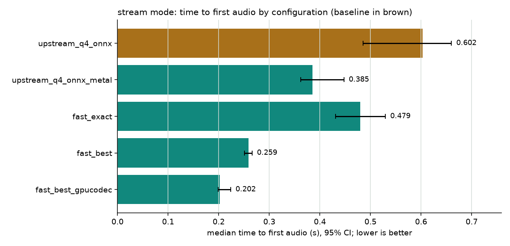
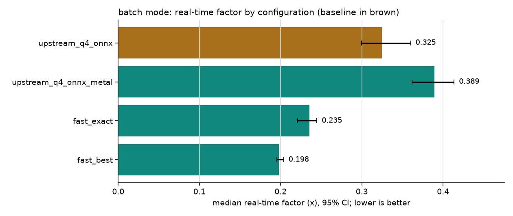
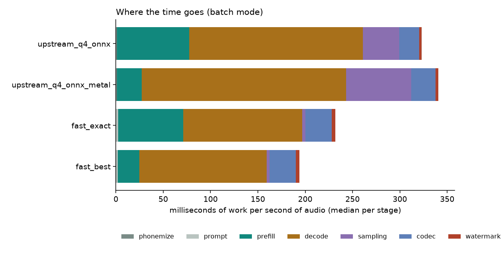

# Design decisions

This document explains what the framework measures, how, and why. It also covers what the
optimised engine changes and the evidence behind each change. Every number here was measured
on the machine below, on the real NeuTTS-Nano weights. Findings marked **[verified]** are
reproduced by a command or test in this repository, named next to the finding.

**Hardware.** MacBook Air (Mac16,12), Apple M4: 4 performance and 6 efficiency CPU cores, a
10-core GPU (Metal 4) and 16 GB of unified memory. macOS 27.0.1, Python 3.12.16, on AC power.
The Air is **fanless**, which turned out to matter a great deal (section 5.1).

---

## 1. Summary

On an M4 MacBook Air, with requests paced like a voice app and every number a median with a
paired 95% bootstrap interval against NeuTTS-Nano exactly as Neuphonic documents it for low
latency (Q4 GGUF backbone + ONNX decoder, CPU):

| | Upstream NeuTTS | Optimised | Change | Quality gates |
|---|---|---|---|---|
| **Streaming: time to first audio** | 0.602 s (p95 0.754) | **0.202 s** (p95 0.249) | **0.36×** [0.35–0.38] | all passed |
| Streaming, same speech tokens as upstream (`fast_exact`) | 0.602 s | 0.479 s | 0.83× [0.80–0.86] | all passed |
| **Batch: real-time factor** (`fast_best`) | 0.325 | **0.198** | **0.60×** [0.58–0.64] | WER inconclusive (+0.006, CI crosses the +0.02 margin) |
| Batch, same speech tokens as upstream (`fast_exact`) | 0.325 | 0.235 | 0.73× [0.71–0.74] | all passed |
| Token generation (batch, `fast_exact`) | 276 tok/s | 402 tok/s | 1.46× | same tokens in 71 of 72 requests (1 exact probability tie) |
| Worst-case memory during a request (max of 72, incl. GPU) | 4.5 GiB | 2.9–3.0 GiB | −33% to −35% (median request: −18% to −27%) | – |
| Load time / cold first request | 13.2 s / 0.95 s | `fast_exact` 9.3 s / 0.76 s; `fast_best` 9.8 s / 0.53 s; `fast_best_gpucodec` 18.6 s / 0.33 s (stream) | – | – |

The largest single gains, each isolated in the ladder (section 8): a speech-only output
vocabulary (the model scores 65,544 instead of 194,256 tokens per step: generation ~1.4× faster
in the suites, 1.6× in a llama-bench microbenchmark, with bit-identical logits), reading the
prompt on the GPU while generating on the CPU (prompt reading ~2.5× faster), leaner token
handling (upstream spends ~38 ms per audio-second outside llama.cpp's prefill and decode, in
sampling and Python detokenize/stop-string/regex work; token ids cut this to 6.6 ms and the
speech-only vocabulary to 3.5 ms), and running the codec on the GPU when streaming. On the
way, one upstream bug was found and fixed (the last streaming chunk is placed one frame late,
measured on real audio), and one inefficiency (streaming watermarks audio it then discards).

The most consequential measurement finding was not about NeuTTS at all: the fanless M4 Air
halves its speed within ~5 s of continuous load (section 5.1). The benchmark therefore paces
requests and cools down between configurations, and reports sustained long-form load
separately (section 8.3).

## 2. What "performance" means here

NeuTTS is built for on-device voice: assistants, agents, toys, phones. There the user
experiences three things, in this order:

1. **How long until the voice starts.** This is the primary streaming metric: time to
   first audio (TTFA).
2. **Whether it keeps up once it has started.** Measured as real-time factor (RTF, compute
   time ÷ audio duration) and streaming underruns, i.e. moments the speaker would run dry.
3. **Whether it still sounds right.** Intelligibility, the same voice, a watermark
   present, and no artefacts from chunked decoding.

Footprint comes next, because the target devices are small: memory, load time and the
cold first request.

On a phone or a fanless laptop there is a fourth dimension: **the load pattern**. A voice
app speaks a sentence, then waits while the user listens and replies. Reading a long
document aloud is continuous. The same code runs at very different speeds in the two cases
(section 5.1), so the framework measures both and labels which one a number belongs to.

**Not optimised for:** server throughput. Batching many concurrent requests is a GPU or
server concern and irrelevant to a single on-device user.

### Metrics

| Group | Metric | How it is measured |
|---|---|---|
| Speed | TTFA | Streaming: call → first yielded chunk. Batch: call → full audio |
| | Total time, RTF | Wall time; RTF = total ÷ audio seconds |
| | Per-stage time | phonemize, prompt, prefill, decode, sampling, codec, watermark, other. `other` = total − named stages (floored at 0): in sequential execution the stages add up to the total and unaccounted time is visible; in pipelined streaming generation overlaps the codec on another thread, so stages measure work and can sum to more than wall time |
| | Prefill / decode tokens/s | GGUF backbones: llama.cpp's own perf counters (`llama_perf_context`). GPU prefill: wall time including the GPU sync and the KV hand-over. PyTorch backbones: GPU-synchronised wall time of each forward pass (first = prefill) |
| | Underruns, stall, headroom | Each chunk's arrival time vs. when playback would need it (`corpus.simulate_playback`) |
| Quality | Word / character error rate | faster-whisper (`small.en`, INT8) transcribes the output; both sides are normalised identically (`quality/text_norm.py`). The gate uses **corpus-level** WER (errors ÷ words over all sentences) with a paired bootstrap over sentences, the standard way ASR systems are compared (Bisani & Ney, 2004) |
| | Speaker similarity | Cosine similarity of ECAPA-TDNN embeddings (SpeechBrain), output vs. the reference recording |
| | Watermark | Perth detection confidence on every scored output; a release gate |
| | Stream fidelity | Log-mel distance (dB) between the (watermarked) streamed audio and an unwatermarked one-pass decode of the **same tokens**. It captures chunked decoding plus the watermark, so the gate uses the change against the baseline, not the absolute value |
| | Failures | Errors, non-EOS stops (context or length cap), long internal silences |
| Footprint | Memory | macOS: the process's *physical footprint* (`proc_pid_rusage`, what Activity Monitor shows), which includes Metal/GPU allocations; RSS elsewhere. Sampled every 10 ms: after load, peak during load, peak per request |
| | Load time, cold TTFA | Construction time; first real request after load (with its mode) |

## 3. How the numbers are made trustworthy

| Decision | Why |
|---|---|
| One fresh process per configuration (`runner.py` → `worker.py`) | Memory, thread pools, allocator state, GPU kernel caches and KV caches from one experiment can't leak into the next. The parent never loads a model |
| Cold request recorded separately, then warm-up, then measurement | Loading and first-call allocations are real costs, but a different question from steady state |
| Cold and warm-up requests use sentences that are never measured | Otherwise shape-specific caches (GPU kernels compiled per input length) would have rehearsed exactly the measured inputs. Found by the code review |
| Fixed seeds | Generation is sampled. With a fixed seed NeuTTS produces identical tokens, so speed differences aren't confused with different takes |
| The same requests per mode for every configuration, shuffled per repeat | Enables **paired** comparison (matched on sentence, voice, seed, repeat, round). Shuffling avoids order effects; configurations that run the same modes also see the same order |
| Paired ratios with bootstrap CIs (`stats.py`) | Removes sentence-length variance. No normality assumption. Medians, not means, for latency |
| Noise floor (±3%) | Statistical significance isn't practical significance. Smaller effects are reported as "within noise" |
| **Paced load + cool-down** (`pacing: playback`, `cooldown_s`) | The M4 Air halves its speed within ~5 s of continuous load and recovers within ~10 s idle (section 5.1). Interactive suites pace each request like a voice app (wait until the previous audio would have finished playing) and idle 30 s before each configuration, so no configuration inherits another's heat. `suites/sustained.yaml` measures the throttled, back-to-back case on purpose, with ABBA rounds |
| Quality scored once per item, after timing, in a separate step | Whisper and ECAPA compete for the CPU and would distort latency. Repeated rounds of the same seeded request are timing replicates, not new quality samples (counting them twice would shrink the confidence intervals). Found by the code review |
| A speed-up is a **win** only if no gate fails or is inconclusive, and word error rate (plus speaker similarity and watermark when enabled) was actually scored | Otherwise the verdict is "rejected", "faster, quality needs more data" or "faster, quality not scored" |
| One-off derived files built before timing | The speech-vocabulary GGUF is built by the runner before any worker starts, so it never lands in a configuration's load time or memory |
| GPU configurations refuse to run without a GPU | llama.cpp silently stays on the CPU when it has no GPU backend; a "Metal" result measured on the CPU would be a lie |
| Reference voices pinned | Downloaded from one NeuTTS commit and checked against SHA-256 hashes (`engines/base.py`), unless a complete local neutts checkout provides them |
| Environment fingerprint in every run | CPU, core counts, CPU features, RAM, OS, power state, package versions, llama.cpp build features, git commit |
| `doctor` preflight | Catches gated-model access, missing espeak, battery power, low-power mode, background load |
| Audio saved for every scored item | Any number a reviewer doubts can be listened to |
| Independent reviews | Before the final runs, an 8-agent read-only code review (4 dimensions, each finding then attacked by a skeptic) found 13 real issues, all fixed; a full run made before the fixes was discarded. Two further read-only reviews checked every claim in this document and the README against the code and the committed reports, and their confirmed corrections are applied |

### Test corpus and voices

The corpus is 36 original sentences in three buckets of 12: short (about 2 s of speech),
medium (about 4 s) and long (about 8 s). They include numbers, times, money, percentages, years,
abbreviations, names, questions, quotes and lists.

Two reference voices, from the NeuTTS repository at commit `ac69851f28`: `jo`, a 13.1 s
clip (653 codes), and `dave`, 7.4 s (372 codes). This deliberately covers a long and a
short prompt, because prompt length drives prefill cost. (The `neutts` 1.4.1 wheel ships
only `emily`, `paul`, `sophie` and `steven`, and no recordings, which speaker similarity
needs, so voices are downloaded from that commit and hash-checked.)

## 4. Framework architecture

```
suite.yaml ─► runner ─► (cool-down) worker: fresh process per config × round
                          ├─ engine.load()            (reference | fast | mock)
                          ├─ cold request, warm-up on unmeasured text, paced measured requests
                          ├─ StageTimer + MemorySampler per request
                          └─ records.jsonl, audio/*.wav, worker_meta.json
              quality  ─► Whisper WER, ECAPA similarity, watermark, silences → quality.jsonl
              report   ─► stats (paired, bootstrapped) → summary.json, report.md, charts/
```

- **ReferenceEngine** runs upstream NeuTTS unmodified. Instrumentation wraps instance
  attributes from outside (phonemizer, prompt builder, the llama.cpp object, codec,
  watermarker), so the baseline is exactly `pip install neutts`. It accepts upstream's own
  `backbone_device` / `codec_device` arguments, so "NeuTTS on the GPU" is also a baseline
  rather than something our engine gets credit for. PyTorch forward hooks synchronise the
  GPU before reading the clock.
- **FastEngine** is the optimised engine (section 6).
- **MockEngine** runs without weights and drives the real streaming code, so the framework
  tests itself in CI. Mock runs are labelled in every report.
- Adding an engine means one class with `load`, `synthesize` and `stream`. Adding an
  experiment means one YAML entry.

## 5. What measuring and reading upstream revealed

Each of these drove a design or optimisation decision, and each was checked, not assumed.

### 5.1 The laptop throttles within seconds **[verified]**

A fixed llama.cpp prefill probe on the 4 performance cores: 3,289 tok/s in the first
second, 1,447 tok/s after 5 s, then a flat ~1,600 tok/s (49%) for as long as the load
lasts. After 10 s idle it is back to 2,500–2,900 tok/s. The same model file measured
2,824 tok/s when cool and 1,215 tok/s a minute later. Consequences:

- Back-to-back benchmarking on this machine measures the throttled regime, which is not
  what a voice-assistant user experiences. Whatever ran later in a sequence would also be
  penalised. Hence pacing and cool-downs (section 3).
- Long-form synthesis really is slower on a fanless device: in `suites/sustained.yaml`
  every configuration's real-time factor was 27–39% higher than for the same sentences paced
  (section 8.3).
- It changes what an optimisation is worth: fewer CPU cycles per token also mean less heat,
  and moving work to the GPU spreads it across two power budgets.

### 5.2 The output head dominates generation **[verified]**

NeuTTS-Nano is a 24-layer Llama (hidden size 576) with a 194,256-token vocabulary: 128k
Llama-3 text tokens, specials and 65,536 speech tokens. The output head is tied to the
embedding table, which is stored at Q8_0 and is **113 MiB of the 185 MiB Q4_0 file**, more
than all transformer layers together. Every generated token scores all 194,256 tokens, but
while speaking the model can only emit the 65,536 speech tokens or
`<|SPEECH_GENERATION_END|>`. Leading to the speech-vocabulary optimisation (6.1).

### 5.3 Upstream spends ~0.75 ms per token outside llama.cpp's compute **[verified: report "sampling" stage]**

NeuTTS calls llama-cpp-python's `create_completion` with a stop string, which detokenizes
every token and checks for the stop string; afterwards a regex extracts the speech ids from
the text. The report's `sampling` stage (time inside generation that is neither prefill nor
decode) is ~38 ms per second of audio upstream on the CPU (38–69 ms with upstream's Metal
switch), and 3–4 ms in our engine, which maps token ids to codes by arithmetic (6.6 ms) and
samples from the speech-only vocabulary (3.5 ms).

### 5.4 The streaming final chunk is one frame late **[verified: `ttsbench verify`]**

NeuCodec's ONNX decoder turns N codes into (N − 1) × 480 samples. Upstream's last streaming
window starts one frame early in the decoded audio but is placed at the next chunk's
offset. Measured on real audio by cross-correlating the final chunk with a one-pass decode
of the same tokens (in the 8 of 10 `verify` cases whose final chunk is long enough to
measure): upstream's tail is 462–494 samples late and the stream is 480 samples longer than the
one-pass decode; with `final_alignment: fixed` the tail is within 18 samples (−18 to +14;
windowed decoding differs very slightly from one-pass decoding) and the length matches
exactly. The original version of this framework claimed the bug from an idealised codec
model and checked the wrong invariant (`tokens × 480`); the real-model run caught it.

### 5.5 Streaming does avoidable work **[verified by code reading + tests]**

- Each 25-frame chunk decodes a window of 82 frames (50 lookback, 25 new, 5 lookahead, 1 + 1
  overlap). Upstream watermarks that whole window, then discards most of it.
- It re-runs overlap-add over *every chunk so far*, which is quadratic in utterance length.

### 5.6 The prompt order limits caching

The prompt is: instruction, reference transcript, **input text**, reference codes. Because
the input text comes before the 372–653 reference codes, their KV cache depends on the text
and can't be reused across requests. Only instruction + reference transcript is shareable;
the fast engine reuses exactly that and nothing more.

### 5.7 Apple-silicon specifics **[verified]**

| Finding | Consequence |
|---|---|
| Prefill: ~8,400 tok/s on the GPU vs ~2,800 on 4 CPU cores (llama-bench, 800 tokens) | Prompt reading belongs on the GPU |
| Generation: 2.7–2.8 ms/token on the CPU vs 3.4–4.7 ms on the GPU at 800 tokens of context | For a 229M-parameter model per-token GPU dispatch overhead dominates; generation stays on the CPU |
| Thread counts behave oppositely for the two phases. With a 15 s cool-down before every measurement and rotated order (`reports/microbench`, section 2): generation 401 tok/s on 4 threads, 402 on 6, 320 on 10; prompt reading 2,004 tok/s on 4 threads, 2,107–2,276 on 10. Each generated token waits for its slowest thread, so an efficiency core holds everyone up; prompt reading is one big job llama.cpp splits dynamically. (An earlier, unrested measurement had suggested 4 threads were best for both: a thermal artefact, caught when the first full run showed our prompt reading 28% slower than upstream's) | Generation on the performance cores (minus one for the codec when streaming), prompt reading on every core |
| `op_offload` (CPU weights, GPU for large batches) gave no measurable gain | Not used |
| ONNX Runtime's CoreML provider fails to load the NeuCodec decoder (`axis 3 is not in valid range`); the older NeuralNetwork format loads but is slower (74 vs 40 ms) | ONNX codec stays on the CPU |
| The PyTorch NeuCodec decoder on Metal: 25 ms per streaming window vs 40–56 ms for ONNX on the CPU; same weights (95 dB SNR once aligned by 240 samples) | GPU codec option for streaming |
| PyTorch on Metal recompiles for every new input length (300 codes: 390 ms first time, 67 ms after) | GPU codec only where lengths are known in advance: streaming windows, all compiled at load |
| Padding the codec input to a fixed length changes the *whole* output (SNR −6 to 28 dB): the decoder attends across its entire input | No padding; batch mode keeps the CPU codec |

### 5.8 Environment and model-file facts **[verified]**

1. The `neutts` 1.4.1 wheel lacks the `jo`/`dave` voices and every recording (section 3).
2. `pip install neutts` can fail to import: torchtune 0.6.1 needs a module removed in
   torchao 0.16+. Pinned to 0.15.0.
3. The prebuilt Metal wheel of llama-cpp-python downloaded corrupted (bad CRC); on macOS the
   Makefile builds it from source with Metal and native CPU kernels (SME2, i8mm), ~1 minute.
4. NeuTTS-Nano's hidden size (576) is not a multiple of 256, so llama.cpp's K-quants
   (Q4_K_M, Q6_K …) don't apply: llama-quantize silently falls back to Q8_0. The original
   custom-quantization plan was therefore void; `scripts/quantize_custom.sh` now builds only
   types that apply.
5. Neuphonic's Q4_0 file was quantized with an importance matrix and keeps three `ffn_down`
   tensors at Q4_1; it is better than a plain conversion, so it is the baseline and the input
   to every optimisation.
6. Hidden sampler settings: upstream passes `temperature=1.0, top_k=50`; llama-cpp-python adds
   `top_p=0.95, min_p=0.05`. The fast engine sets all of them explicitly, so its tokens can be
   identical to upstream.

## 6. The optimised engine and the ladder

`suites/ladder.yaml` changes **one thing per step**, so every gain is attributable.

| Step | Change | Cost it attacks | Output identical to upstream? |
|---|---|---|---|
| L00 | NeuTTS out of the box: PyTorch bf16 backbone + PyTorch codec, CPU | – | (is upstream) |
| L01 | The same on the GPU with upstream's own `backbone_device="mps"`, `codec_device="mps"` | all | (is upstream) |
| L02 / L03 | Neuphonic's documented latency path: GGUF Q8 / Q4 + ONNX decoder. **L03 is the baseline** | all | (is upstream) |
| L04 | L03 with upstream's GPU switch (`backbone_device="mps"`: Metal + flash attention) | prefill | (is upstream) |
| L05 | Our engine, same output and upstream's backbone and codec thread settings (the Perth watermarker runs on one torch thread): token ids instead of string formatting and regex, incremental overlap-add | sampling, other | Yes (`verify`) |
| L06 | Codec on one thread with ONNX Runtime spin-waiting off; backbone threads `auto` (on a Mac the same counts upstream uses: generation on the performance cores, prompt reading on all cores) | codec | Yes |
| L07 | Watermark only the emitted slice (streaming) | watermark | Audio differs only in watermark placement; detection gated |
| L08 | Pipelining: codec and watermark on a second thread while tokens keep generating (generation then leaves one performance core for it when streaming) | stream TTFA, underruns | Yes (`verify`) |
| L09 | Keep the per-voice prompt prefix in llama.cpp's KV cache, reading the rest in prefill-aligned chunks | prefill | Yes (`verify`, incl. long sentences) |
| L10 | **Speech-only vocabulary** (6.1) | decode, sampling, memory | Yes: logits bit-identical; tokens identical except at exact probability ties (1 of 72 corpus requests) |
| L11 | Correct final-chunk alignment | quality | Fixes upstream's one-frame misplacement |
| L12 | Flash attention on the CPU | prefill | No: numerically close, quality-gated |
| L13 | **GPU prefill, CPU generation** (6.2) | prefill (TTFA) | No: numerically close, quality-gated |
| L14 | 10-frame (0.2 s) first chunk | stream TTFA | Same tokens; different chunking, fidelity-gated |
| L15 | Codec on the GPU (PyTorch NeuCodec on Metal), streaming only | codec | No: 95 dB SNR vs ONNX, quality-gated |
| X1, X2 | INT8 ONNX decoder; the Q8 backbone with every engine change | trade-offs | No: quality-gated |

The default suite runs the two upstream baselines (CPU and upstream's own Metal switch) and
three optimised configurations: `fast_exact` (L11: everything that keeps the tokens
identical), `fast_best` (L14) and `fast_best_gpucodec` (L15, streaming only).

### 6.1 Speech-only vocabulary (`vocab: speech`, `engines/vocab.py`)

`prune_gguf` writes a copy of the backbone whose tied embedding/output matrix keeps only the
END token, the 65,536 speech tokens and the 7 special tokens just below them: 65,544 rows
instead of 194,256. Every other tensor is copied byte for byte. The file shrinks from 185 to
103 MiB.

The text part of the prompt (instruction, phonemes) has no rows in the pruned model, so the
engine tokenizes with the original vocabulary (a vocab-only load of the original file) and
feeds the **prompt as embeddings**, looked up in the original table and dequantized exactly
as llama.cpp's `get_rows` does (`y = q × d` in float32; unit-tested bit-exact against the
`gguf` reference). The network therefore sees identical inputs. Generation mirrors
llama-cpp-python's `generate` step for step (prefill chunked by `n_batch`, the same sampler
chain built in the same order, sample then decode) and maps ids back by a fixed offset.

Why 65,544 and not 65,537: llama.cpp's CPU backend repacks a weight for its fastest GEMV
kernel only if the row count is a multiple of 4 (NEON) or 8 (AVX2). With 65,537 rows the
head fell back to a generic kernel that is slower *and* accumulates in a different order, so
logits differed in the last bits. The code review caught this; padding with real rows fixed
both.

Why tokens stay identical: logits of every kept token are bit-identical to the full model's
(`verify` compares them; max |diff| = 0), and top-k (k = 50) is the first sampler after a
no-op repeat penalty. As long as the 50 most likely tokens are kept tokens (`verify` reports this
for the first generated step of each case: true in all of them; `scripts/microbench/diverge.py`
checked every step of a 439-token request: true at all of them), every later sampler sees the
same candidates, and the seeded draw picks the same token.

The one exception is an exact tie. llama.cpp's top-k uses an unstable partial sort, so when
two of the top 50 candidates have bit-identical logits, their order (and therefore which of
the two the seeded draw lands on) depends on the length of the array being sorted. Both
tokens have exactly the same probability, so either is an equally valid sample from the same
distribution. Across the full default corpus this happened in 1 of 72 requests (l05, voice
dave), at step 282 of 439: the only step of that request with a tie in the top 50, and the
first step where the outputs differ. The full-vocabulary engine with the same settings
matched upstream for all 439 tokens. **[verified: diagnosis run on the real model]**

Measured with llama-bench (4 performance cores, cool; `reports/microbench`, section 3, on the
first 65,537-row version): generation 348 → 556 tok/s on the CPU (1.6×) and 287 → 383 tok/s on
Metal; prefill unchanged. In the suites, with sampling and everything else included, the step
is 277 → 401 tok/s (ladder L10).

### 6.2 GPU prefill, CPU generation (`prefill_gpu`)

A second llama.cpp context on Metal (same mmap-shared weights) reads the prompt, the first
token is sampled from its logits, and its KV cache (14.8 MB for 800 tokens) is copied into the
CPU context with `llama_state_seq_get_data/set_data`; the CPU context generates the rest. Both
contexts use flash attention, because the V-cache layout differs with and without it.
In the default suite prompt reading runs at ~2,650 tok/s upstream on the CPU and
~6,450–6,900 tok/s here including the copy (≈300 vs ≈120 ms for an 800-token prompt); the
first generated token arrives at 0.11 s instead of 0.44 s in streaming (medians). The prompt's KV is numerically different from a CPU
prefill, so this is quality-gated rather than claimed as identical.

### 6.3 Other mechanisms

- **Pipelining.** llama.cpp and ONNX Runtime release the GIL inside native calls, so a
  producer thread generating tokens and a consumer decoding audio really do run in parallel.
- **Thread counts per phase and request mode.** `auto` reads the prompt on every core and
  generates on the performance cores: all of them in batch mode, all but one when streaming
  (the codec thread needs one), switched per request with `llama_set_n_threads`. With the GPU
  codec no core is reserved.
- **Prefix reuse, done honestly and exactly.** A naive KV cache would let a *repeated benchmark
  sentence* skip almost all prefill, a gain real traffic never sees. After each request the engine
  truncates the cache to the per-voice prefix; input-text phonemes are never cached. The rest of
  the prompt is then read in chunks that start at the same absolute positions as a full prefill
  (multiples of 512), and the reused prefix is rounded down to a multiple of 8, so every prompt
  row goes through the same kernel row-group as in a full prefill. The first version chunked from
  the reuse point; the first full run showed 12 of 72 batch and 15 of 72 streaming requests (all on long
  sentences) diverging from upstream's tokens because of it, while `verify`'s short sentences all matched. `verify` now
  includes long sentences and treats prefix reuse as a mandatory exact check.
- **GPU codec warm-up.** Every window length the streaming schedule can produce (52–82 codes
  for the default schedule) is compiled at load, so no measured request pays for a compile; the
  cost shows up honestly as load time.
- **Avoiding torch and transformers in the hot path.** The fast engine loads NeuTTS's
  phonemizer module directly instead of importing the package. Torch is still loaded once by
  the Perth watermarker.

## 7. Correctness

`ttsbench verify` (= `make verify`) runs upstream and the fast engine side by side on the
real model (5 sentences × 2 seeds, voice `jo`) and checks:

| Check (10 sentence × seed cases, incl. two long sentences) | Result |
|---|---|
| Identical speech tokens, batch | 10/10 |
| Sample-identical streamed audio in upstream-compatible mode (max \|diff\| = 0) | 10/10 |
| Identical tokens from the pipelined (two-thread) streamer | 10/10 |
| Identical tokens with the voice prefix reused from the KV cache | 10/10 |
| Fixed final alignment: stream exactly as long as a one-pass decode | 10/10 |
| Final chunk placement vs a one-pass decode (8 of 10 long enough to measure): upstream +462 to +494 samples late, fixed −18 to +14 (pass: \|lag\| < 120) | 10/10 |
| Speech-vocabulary logits bit-identical to the full model's (65,544 compared) | 10/10 |
| Speech-vocabulary tokens identical, batch and stream | 20/20 |
| **All mandatory checks** | **90/90 passed** |

Beyond `verify`, the full default run compares every request: `fast_exact` generated the same
tokens as upstream for 71 of 72 requests in each mode; the 72nd differs from an exact
probability tie onwards (section 6.1). Its quality matched upstream within ±0.007 WER and
±0.001 speaker similarity.

Unit tests (67, no weights needed) prove the streaming core is sample-identical to
upstream's code across reference lengths, utterance lengths and chunk settings; that
pruning keeps rows byte for byte and that embedding lookup is bit-exact for Q8_0, Q4_0 and
F16; and they cover the statistics, playback model, config validation, text normalisation,
and an end-to-end run of the whole framework.

## 8. Results

All runs are in `reports/` (report, machine-readable summary, charts, environment). The
numbers below are from `reports/m4-default` unless stated otherwise.

### 8.1 Default suite: upstream vs the optimised engine

36 sentences × 2 voices × batch and streaming, paced at playback speed, 30 s cool-down before
each configuration, quality scored with Whisper `small.en` (corpus-level WER), ECAPA speaker
similarity and Perth watermark detection.

**Streaming** (primary metric: time to first audio)

| Config | TTFA median [95% CI] | TTFA p95 | RTF | vs upstream | Verdict |
|---|---|---|---|---|---|
| `upstream_q4_onnx` (baseline) | 0.602 [0.485–0.660] | 0.754 | 0.408 | – | – |
| `upstream_q4_onnx_metal` (upstream's GPU switch) | 0.385 [0.362–0.447] | 0.481 | 0.354 | 0.70× | win |
| `fast_exact` (same tokens as upstream) | 0.479 [0.431–0.529] | 0.630 | 0.270 | 0.83× | win |
| `fast_best` | 0.259 [0.251–0.266] | 0.310 | 0.231 | 0.45× | win |
| `fast_best_gpucodec` | **0.202** [0.199–0.224] | **0.249** | **0.180** | **0.36×** | win |

No configuration had a single underrun in 72 streamed requests. Stream fidelity (log-mel
distance to a one-pass decode of the same tokens) improved from 2.88 dB upstream to 2.60 dB,
all of it from the fixed final chunk (the ladder shows slice watermarking alone leaves it
unchanged).

**Batch** (primary metric: real-time factor)

| Config | RTF median [95% CI] | Total s | Decode tok/s | vs upstream | Verdict |
|---|---|---|---|---|---|
| `upstream_q4_onnx` (baseline) | 0.325 [0.300–0.360] | 1.327 | 276 | – | – |
| `upstream_q4_onnx_metal` | 0.389 [0.362–0.414] | 1.450 | 234 | 0.97× | within noise |
| `fast_exact` | 0.235 [0.221–0.245] | 0.945 | 402 | 0.73× | win |
| `fast_best` | **0.198** [0.196–0.204] | 0.823 | 374 | **0.60×** | faster, WER inconclusive |

**Where the time goes** (ms of work per second of audio, batch):

| Config | prefill | decode | sampling | codec | watermark |
|---|---|---|---|---|---|
| upstream | 76.5 | 183.3 | 38.2 | 21.1 | 2.9 |
| `fast_exact` | 69.0 | 125.5 | 3.5 | 27.9 | 3.8 |
| `fast_best` | 22.7 | 134.3 | 3.2 | 27.9 | 3.8 |

Upstream's own GPU switch is a useful control: it makes streaming start sooner (prompt
reading on Metal) but batch synthesis no faster, because in batch mode per-token generation on
Metal was slower than on the CPU (234 vs 276 tok/s) and the time outside llama.cpp's prefill and
decode counters grew (69 vs 38 ms/s); in streaming the two were level (278 vs 274 tok/s). That
is exactly the split `prefill_gpu` exploits.

**Quality.** Corpus WER 0.026–0.034 for every configuration (upstream 0.027 batch, 0.033
stream), speaker similarity within +0.012 of upstream, watermark detected on 100% of outputs,
no errors, no non-EOS stops. The largest per-sentence WER changes are listed in the report;
most are number and time formatting ("4719" vs "four seven one nine", "8am" vs "888M"), with a
few single-word substitutions ("at"/"of", "called"/"call"), in both directions. `fast_best`'s
batch WER gate is "inconclusive", not failed: its corpus WER is +0.006 with a confidence interval
that reaches past the +0.02 margin, which 72 requests (36 sentences × 2 voices) can't rule out.
To listen, `samples/` holds streamed clips from this run: the first sentence of each length bucket in
both voices, from every configuration (chosen by that fixed rule, not by ear).

**Footprint.** The worst-case physical footprint during a request (max over 72) is 4.5 GiB
upstream vs 2.9–3.0 GiB for every optimised configuration (−33% to −35%; −18% to −27% for the
median request). After load it is 1.83 GiB upstream vs 1.60–1.65 GiB for the CPU-codec
configurations: upstream imports the neutts package (with transformers and the PyTorch codec
module), which those avoid; torch is loaded by the Perth watermarker in both. Where upstream's
extra growth during requests comes from was not investigated. The GPU codec adds 1.3 GiB after
load and ~8.8 s of load time (18.6 s in total against 9.8 s for `fast_best`), spent compiling
every streaming window shape up front; its worst-case request peak (3.0 GiB) is in the same
range as the other optimised configurations, its median request peak ~10% higher.





### 8.2 The ladder: what each change bought

`reports/m4-ladder`: 12 medium sentences (~4 s of speech, 2.9–5.5 s) × 2 voices × batch and
streaming, paced, 30 s cool-down per step. Every step changes one thing. L02, L04 and L05 are
paired against the baseline L03; from L06 on each row is paired against the step before it, and
X1/X2 against L14 (ratio < 1 = faster). The full table with 95% intervals is
`reports/m4-ladder/steps.md`, generated by `scripts/ladder_steps.py`.

| Step | Change | Batch RTF | Stream TTFA | Stream total |
|---|---|---|---|---|
| L00 → L03 | Upstream out of the box (PyTorch bf16, CPU) → upstream's documented GGUF Q4 + ONNX path | RTF 1.30 → 0.317 (4.3×) | – | – |
| L01 | Upstream PyTorch on the GPU (`backbone_device="mps"`) | RTF 0.695, peak memory 6.0 GiB | – | – |
| L02 | Upstream with the Q8 backbone instead of Q4 | 1.13× slower | within noise | – |
| L04 | Upstream's own Metal switch | within noise | 0.71× | – |
| **L05** | **Leaner engine, same output and threads** (token ids instead of strings/regex; incremental overlap-add) | **0.92×** | **0.84×** | 0.92× |
| L06 | Codec on one thread, spin-waiting off | within noise (1.04×) | within noise | 1.06× slower |
| L07 | Watermark only the emitted slice | within noise | within noise | within noise |
| L08 | Pipelining (codec on a second thread) | within noise | 1.14× (slower) | **0.87×** |
| L09 | Exact prefix reuse | within noise (0.96×) | within noise (0.96×) | within noise |
| **L10** | **Speech-only vocabulary** | **0.81×** | within noise (0.93×) | **0.83×** |
| L11 | Correct final-chunk alignment | within noise | within noise | within noise |
| L12 | Flash attention on the CPU | within noise | 0.89× | within noise |
| **L13** | **GPU prefill, CPU generation** | **0.88×** | **0.72×** | 0.86× |
| L14 | 0.2 s first chunk | within noise | 0.85× | within noise |
| **L15** | **Codec on the GPU** (streaming) | – | 0.84× | **0.79×** |
| X1 | INT8 ONNX codec instead of FP32 (vs L14) | 0.95× | 0.84× | 0.88× |
| X2 | Q8 backbone instead of Q4 (vs L14) | 1.20× (slower) | 1.08× (slower) | 1.20× (slower) |

("Within noise" means the 95% interval reached inside 1 ± 3%, the suite's noise floor.)

What the ladder says:

- **Three changes carry most of the gain**: the speech-only vocabulary (generation 277 →
  401 tok/s, batch 0.81×), GPU prefill (time to first audio 0.72×), and the leaner engine
  (time outside llama.cpp's compute: 38 → 6.6 ms per audio-second).
- **Two steps are honest trade-offs, not wins.** One codec thread (L06) is meant for when the
  codec runs beside generation (L08); that benefit wasn't measured separately. Where the codec
  runs alone it costs: 1.04× in batch (inside the noise floor; the codec stage rises from 19.7
  to 27.6 ms per audio-second) and 1.06× in streaming total time. A per-mode codec session would
  avoid it (section 11). Pipelining (L08) finishes the stream 13% sooner but starts it 14% later
  on the CPU, because generation gives up a core; with the GPU codec (L15) that core is returned
  and both improve.
- **Slice watermarking (L07)** removes 60% of watermark work (13.5 → 5.7 ms/s) but watermarking
  is a small stage, so the end-to-end change is ~2%.
- **The 8-bit backbone (X2)** is 20% slower than the 4-bit one with no quality gain to show,
  confirming Neuphonic's choice of Q4 as the latency path. **The INT8 codec (X1)** is 5–16%
  faster than FP32 and uses the least memory of any configuration (1.1 GiB after load), with no
  quality gate failing: the best option for a memory-constrained device, at the cost of 27 dB
  SNR against the FP32 decoder (`reports/microbench`, section 5).
- **Quality across the ladder**: watermark detected on 100% of outputs, no errors, speaker
  similarity never more than 0.014 below upstream (and up to 0.033 above). Several WER gates read "inconclusive" because 24 requests per mode
  (12 sentences × 2 voices) are too few to bound a 0.02 change, and Whisper itself is not perfectly stable: on one
  sentence (m11, jo) it stopped transcribing after "The temperature will drop t" for steps
  L07–L10, whose audio is token-identical to L06's and 41 dB SNR from it; L06 and L11 were
  transcribed perfectly. The report's "largest word-error changes" table exposes cases like this
  instead of burying them in an average.

### 8.3 Sustained load: long-form synthesis on a throttling laptop

`reports/m4-sustained`: the 12 long sentences (~8 s of speech, 6.3–9.5 s) × 2 voices × batch and
streaming, **back to back with no pauses**, two rounds in ABBA order (48 requests per mode per
configuration). This is reading a document aloud on a fanless device.

| Config | Batch RTF | vs upstream | Stream TTFA (p95) | vs upstream | Batch generation |
|---|---|---|---|---|---|
| `upstream_q4_onnx` | 0.380 | – | 0.800 s (1.118) | – | 188 tok/s |
| `upstream_q4_onnx_metal` | 0.314 | 0.83× | 0.450 s (0.672) | 0.58× | 218 tok/s |
| `fast_exact` | 0.275 | 0.74× (win) | 0.658 s (0.881) | 0.78× (win) | 295 tok/s |
| `fast_best` | **0.237** | **0.63×** | **0.265 s** (0.322) | **0.33×** | 290 tok/s |

- **Throttling is visible in real work.** On the same long sentences, the paced default run
  vs this one: CPU generation is 21–29% slower (upstream 265 → 188 tok/s, `fast_exact` 391 →
  295) and CPU prompt reading 16–25% slower, while GPU prompt reading barely moves (−8% to
  +11%); real-time factors are 27–39% higher for every configuration. Nothing ran out of
  buffer: zero underruns in 192 streamed requests, although `fast_best`'s smallest headroom
  (0.09 s, with its 0.2 s first chunk) is the tightest.
- **The load pattern changes the ranking.** Upstream's own Metal switch made no measurable
  batch difference when paced (0.97×) but is 17% faster under sustained load. Two effects
  point the same way: the CPU throttles while the GPU has its own power budget, and Metal
  generation itself was *faster* under continuous load (long sentences: 133 tok/s paced vs
  218 sustained), consistent with the GPU clocking down between paced requests (not
  investigated further). GPU prefill keeps `fast_best`'s streaming start nearly unchanged
  (0.259 s paced, 0.265 s sustained) while upstream's degrades (0.602 → 0.800 s).
- **Quality** holds: watermark 100%, no errors, corpus WER within ±0.007 of upstream. Speaker
  similarity gates for the numerically different configurations read "inconclusive" (largest:
  `fast_best` streaming −0.020, exactly at the margin), so the long-form quality of `fast_best`
  deserves a larger sample before being called equivalent; `fast_exact` passes every gate.

## 9. What did not help (negative results)

| Tried | Result | Why |
|---|---|---|
| Whole backbone on Metal (upstream's GPU switch) | Paced batch no faster (0.97×), generation 234 vs 276 tok/s; under sustained load it does help (0.83×, section 8.3) | Per-token GPU dispatch overhead dominates a 229M model; only prompt reading benefits reliably, hence `prefill_gpu` |
| All 10 cores for generation | 320 vs 401 tok/s (`reports/microbench`) | Each token waits for its slowest thread; efficiency cores slow every step |
| 4 performance cores for prompt reading | 2,004 vs 2,107–2,276 tok/s on 10 | The original default; an unrested measurement had made it look right (section 5.7) |
| ONNX Runtime CoreML execution provider | Fails to load the NeuCodec graph; the NeuralNetwork format is slower (74 vs 40 ms) | Graph not supported as exported |
| PyTorch codec on Metal for batch synthesis | Slower than the CPU on unseen lengths (300 codes: 390 ms on first use vs 126 ms for ONNX on the CPU; 67 ms once compiled) | Metal recompiles for every new input length |
| Padding codec input to fixed lengths | Changes the whole output (SNR −6 to 28 dB) | The decoder attends across its whole input |
| `op_offload` (CPU weights, GPU for large batches) | No measurable change | Copy overhead cancels the gain for a model this size |
| K-quants (Q4_K_M, Q6_K …) | Not applicable | Hidden size 576 is not a multiple of 256 |
| Prefix reuse chunked from the reuse point | 12 of 72 batch and 15 of 72 streaming requests (all long sentences) diverged from upstream | Different kernel row grouping; fixed by aligned chunks (section 6.3) |
| Whisper `base.en` as the WER scorer | Hallucinated a string of digits on token-identical audio | Replaced by `small.en` and a corpus-level gate |
| The pruned head at 65,537 rows | Slower kernel, last-bit logit differences | Padded to 65,544 rows (section 6.1) |

## 10. Limitations and threats to validity

- **One machine, and a fanless one.** Thread choices, the GPU/CPU split and the size of
  every gain are machine-specific. A MacBook Pro or a phone will throttle differently.
  That's why they are configs and `doctor` output, not constants.
- **Background load.** This was the author's everyday laptop; other apps were running.
  Pacing, cool-downs, paired comparisons and the noise floor reduce but can't remove that.
- **Scorer bias.** Whisper and ECAPA have their own errors. Deltas against the baseline
  cancel most of it, but small absolute differences in word error rate are within ASR noise.
- **Sampled generation.** Seeds fix it per request, but different seeds give different
  takes. Use `seeds: [0, 1, …]` for more coverage.
- **Numerically different ≠ worse, and ≠ identical.** Flash attention, GPU prefill and the
  GPU codec change floating-point results, so the generated tokens differ from upstream's
  for the same seed. They are accepted only through the quality gates, not by assumption.
- **Context budget.** With the long `jo` reference, long inputs approach the 2,048-token
  limit. The report counts non-EOS stops.

## 11. What I'd do next

1. **A per-mode codec session.** One ONNX codec thread is right while streaming (the codec runs
   beside generation) and costs ~4% in batch, where it runs alone (ladder L06). Two sessions
   sharing one copy of the weights (ONNX Runtime's prepacked-weights container) would give each
   mode its best thread count without doubling the 783 MB decoder.
2. **More power for the quality gates.** 72 requests per mode can't bound a 0.02 WER change
   tightly, and Whisper `small.en` still misfires occasionally on near-identical audio. More
   sentences and seeds, a larger ASR model for the gate, and scoring each clip twice would
   settle the "inconclusive" verdicts, especially `fast_best`'s long-form speaker similarity.
3. **Run the codec on the Neural Engine** via a static-shape Core ML export of the streaming
   windows (the shapes are known; ONNX Runtime's CoreML provider can't load the graph as
   exported). That would free both the CPU and the GPU for the backbone.
4. **Quantize the pruned output head** (Q8_0 → Q4_0, 38 → 20 MiB) and measure it against the
   quality gates; it is the largest remaining tensor read per generated token.
5. **A shorter, curated reference clip per voice**, the largest remaining prefill cost, measured
   as a curve of prefill time against speaker similarity.
6. **Investigate GPU clock ramp-up** between paced requests (section 8.3): if Metal work is
   slow after idle, a short warm-up kernel when a conversation turn starts could hide it.
7. **Upstream the fixes** to NeuTTS: the final-chunk alignment, slice watermarking, the
   speech-only head, and exact prefix reuse.
8. **Energy per audio-second** (powermetrics on macOS needs root) as a footprint metric; on a
   fanless device energy and sustained speed are the same problem.
