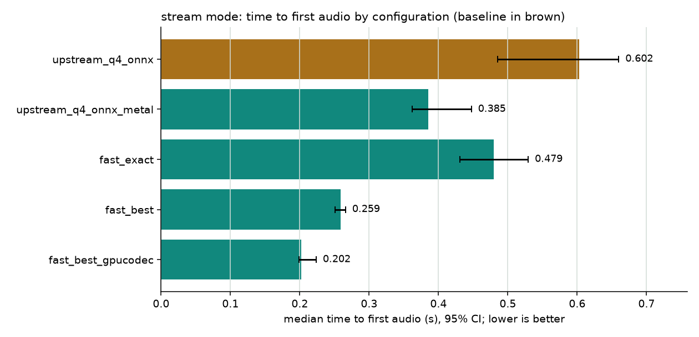
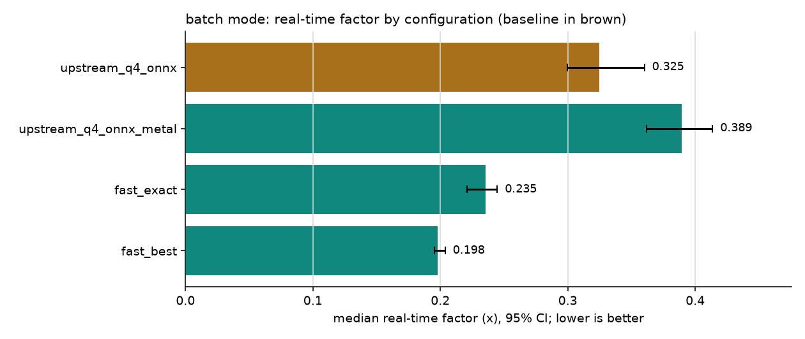
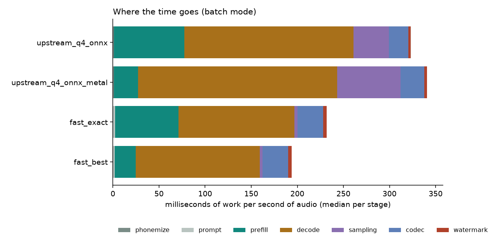
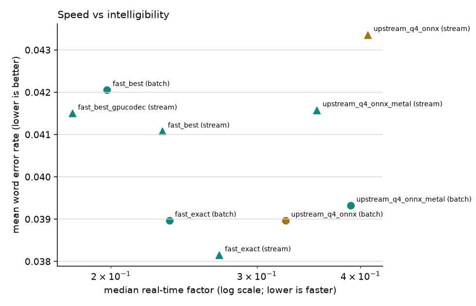

# NeuTTS benchmark report: `m4-default`

**Hardware:** Apple M4 · 10C/10T (4 perf) · 16.0 GB RAM · macOS-27.0.1-arm64-arm-64bit · Python 3.12.16  
**CPU features:** FEAT_BF16, FEAT_DotProd, FEAT_I8MM  
**llama.cpp build:** `MTL : EMBED_LIBRARY = 1 | CPU : NEON = 1 | ARM_FMA = 1 | FP16_VA = 1 | MATMUL_INT8 = 1 | DOTPROD = 1 | SME = 1 | SME2 = 1 | ACCELERATE = 1 | REPACK = 1 |`  
**Power:** {"on_ac_power": true, "battery_percent": 100, "low_power_mode": false}  
**Suite:** `default`: 5 configs, 1 repeats × 1 seeds × 2 voices, 1 round(s), warm-up 3, noise floor ±3%. Baseline: `upstream_q4_onnx`.  
**Load pattern:** requests paced at playback speed (each waits until the previous audio would have finished playing, plus 0.5 s), as a voice app runs; 30 s idle before each configuration.  
**Quality scorers:** Whisper `small.en` (word error rate, corpus-level), ECAPA-TDNN speaker similarity, Perth watermark detection  
**Run:** 2026-11-01T01:58:23 → 2026-11-01T03:07:43

Every number is a median with a 95% bootstrap confidence interval in brackets. Comparisons are paired: each configuration ran the identical requests (sentence, voice, seed, repeat).

## Headline

- **stream:** time to first audio 0.602 → 0.202 with `fast_best_gpucodec` (paired ratio 0.360× [0.346–0.381], quality gates passed).
- **batch:** real-time factor 0.325 → 0.235 with `fast_exact` (paired ratio 0.729× [0.712–0.735], quality gates passed).

## Stream mode

| Config | TTFA s | Total s | RTF | Prefill tok/s | Decode tok/s | Peak memory MB (requests) | OK |
|---|---|---|---|---|---|---|---|
| `upstream_q4_onnx` | 0.602 [0.485–0.660] | 1.627 [1.458–1.917] | 0.408 [0.376–0.422] | 2643 | 274 | 4614 | 72/72 |
| `upstream_q4_onnx_metal` | 0.385 [0.362–0.447] | 1.514 [1.203–1.755] | 0.354 [0.341–0.365] | 7777 | 278 | 4414 | 72/72 |
| `fast_exact` | 0.479 [0.431–0.529] | 1.074 [0.981–1.274] | 0.270 [0.248–0.290] | 2411 | 312 | 2997 | 72/72 |
| `fast_best` | 0.259 [0.251–0.266] | 0.910 [0.818–1.109] | 0.231 [0.225–0.242] | 6634 | 279 | 3085 | 72/72 |
| `fast_best_gpucodec` | 0.202 [0.199–0.224] | 0.747 [0.613–0.874] | 0.180 [0.177–0.192] | 6894 | 349 | 3058 | 72/72 |

**Where the time goes** (median ms of work per second of audio):

| Config | phonemize | prompt | prefill | decode | sampling | codec | watermark | other |
|---|---|---|---|---|---|---|---|---|
| `upstream_q4_onnx` | 0.9 | 0.1 | 80.7 | 182.2 | 37.8 | 89.0 | 12.0 | 0.7 |
| `upstream_q4_onnx_metal` | 1.1 | 0.1 | 26.0 | 179.7 | 37.7 | 93.3 | 15.4 | 0.8 |
| `fast_exact` | 0.4 | 1.6 | 70.1 | 160.9 | 3.8 | 170.8 | 6.6 | 0.0 |
| `fast_best` | 0.4 | 1.7 | 23.4 | 181.4 | 3.5 | 177.7 | 6.8 | 0.0 |
| `fast_best_gpucodec` | 0.4 | 1.7 | 24.7 | 143.9 | 3.4 | 63.1 | 7.8 | 0.0 |

**Streaming health:**

| Config | Requests with underruns | Median stall s | Min headroom s (p50) | Fidelity dB (vs one-pass decode) |
|---|---|---|---|---|
| `upstream_q4_onnx` | 0/72 | 0.000 | 0.357 | 2.88 |
| `upstream_q4_onnx_metal` | 0/72 | 0.000 | 0.356 | 2.93 |
| `fast_exact` | 0/72 | 0.000 | 0.403 | 2.60 |
| `fast_best` | 0/72 | 0.000 | 0.106 | 2.59 |
| `fast_best_gpucodec` | 0/72 | 0.000 | 0.144 | 2.71 |

## Batch mode

| Config | TTFA s | Total s | RTF | Prefill tok/s | Decode tok/s | Peak memory MB (requests) | OK |
|---|---|---|---|---|---|---|---|
| `upstream_q4_onnx` | 1.327 [1.124–1.564] | 1.327 [1.124–1.564] | 0.325 [0.300–0.360] | 2662 | 276 | 4542 | 72/72 |
| `upstream_q4_onnx_metal` | 1.450 [1.036–1.842] | 1.450 [1.036–1.842] | 0.389 [0.362–0.414] | 7710 | 234 | 4348 | 72/72 |
| `fast_exact` | 0.945 [0.815–1.116] | 0.945 [0.815–1.116] | 0.235 [0.221–0.245] | 2372 | 402 | 2977 | 72/72 |
| `fast_best` | 0.823 [0.655–0.941] | 0.823 [0.655–0.941] | 0.198 [0.196–0.204] | 6454 | 374 | 3065 | 72/72 |

**Where the time goes** (median ms of work per second of audio):

| Config | phonemize | prompt | prefill | decode | sampling | codec | watermark | other |
|---|---|---|---|---|---|---|---|---|
| `upstream_q4_onnx` | 1.0 | 0.1 | 76.5 | 183.3 | 38.2 | 21.1 | 2.9 | 0.0 |
| `upstream_q4_onnx_metal` | 1.1 | 0.1 | 26.0 | 216.0 | 68.9 | 25.6 | 2.9 | 0.1 |
| `fast_exact` | 0.4 | 1.8 | 69.0 | 125.5 | 3.5 | 27.9 | 3.8 | 0.0 |
| `fast_best` | 0.4 | 1.8 | 22.7 | 134.3 | 3.2 | 27.9 | 3.8 | 0.0 |

## Compared with the baseline

Ratio = candidate ÷ baseline per request (below 1 is faster). Quality deltas are candidate − baseline; WER Δ is corpus-level (errors ÷ words over all sentences) with a paired bootstrap.

| Config | Mode | Primary metric ratio | Speed | WER Δ | Speaker sim Δ | Gates | Verdict |
|---|---|---|---|---|---|---|---|
| `upstream_q4_onnx_metal` | batch | 0.968× [0.922–1.047] | within noise | -0.001 | +0.011 | wer:pass, spk_sim:pass, watermark:pass, failures:pass | **no measurable change** |
| `upstream_q4_onnx_metal` | stream | 0.704× [0.679–0.722] | faster | -0.003 | +0.006 | wer:pass, spk_sim:pass, watermark:pass, fidelity:pass, failures:pass | **win** |
| `fast_exact` | batch | 0.729× [0.712–0.735] | faster | +0.000 | +0.000 | wer:pass, spk_sim:pass, watermark:pass, failures:pass | **win** |
| `fast_exact` | stream | 0.831× [0.803–0.859] | faster | -0.007 | +0.001 | wer:pass, spk_sim:pass, watermark:pass, fidelity:pass, failures:pass | **win** |
| `fast_best` | batch | 0.604× [0.578–0.641] | faster | +0.006 | +0.012 | wer:inconclusive, spk_sim:pass, watermark:pass, failures:pass | **faster, quality needs more data** |
| `fast_best` | stream | 0.448× [0.428–0.489] | faster | -0.003 | +0.011 | wer:pass, spk_sim:pass, watermark:pass, fidelity:pass, failures:pass | **win** |
| `fast_best_gpucodec` | stream | 0.360× [0.346–0.381] | faster | +0.001 | +0.007 | wer:pass, spk_sim:pass, watermark:pass, fidelity:pass, failures:pass | **win** |

**Largest word-error changes against the baseline** (per sentence; listen to these first):

| Config | Mode | Sentence | Voice | WER Δ | Baseline heard | Candidate heard |
|---|---|---|---|---|---|---|
| `upstream_q4_onnx_metal` | batch | m08 | dave | +0.25 | Your package with tracking number four seven one nine will arrive tomorrow between noon an | Your package with tracking number 4719 will arrive tomorrow between noon and 3. |
| `upstream_q4_onnx_metal` | batch | s06 | dave | -0.20 | called Dr. Patel back today. | call Dr. Patel back today. |
| `upstream_q4_onnx_metal` | batch | s07 | dave | +0.17 | Battery at 15%, please charge. | Battery of 15%, please charge. |
| `upstream_q4_onnx_metal` | stream | s06 | dave | -0.20 | called Dr. Patel back today. | Call Dr. Patel back today. |
| `upstream_q4_onnx_metal` | stream | s07 | dave | +0.17 | Battery at 15 percent please charge | Battery of 15%, please charge. |
| `upstream_q4_onnx_metal` | stream | m05 | jo | +0.14 | I'm not sure that's right. Let's check the figures again before we send it. | I'm not sure that's rights, check the figures again before we send it. |
| `fast_exact` | stream | m08 | dave | -0.25 | Your package with tracking number 4719 will arrive tomorrow between noon and 3. | Your package with tracking number four seven one nine will arrive tomorrow between noon an |
| `fast_exact` | stream | l02 | dave | -0.12 | Our support team is available from Monday to Friday between AA.M and APA.M, and you can al | Our support team is available from Monday to Friday between 8a.m and 8p.m, and you can als |
| `fast_best` | batch | m08 | dave | +0.25 | Your package with tracking number four seven one nine will arrive tomorrow between noon an | Your package with tracking number 4719 will arrive tomorrow between noon and 3. |
| `fast_best` | batch | l02 | jo | +0.25 | Our support team is available from Monday to Friday between 8am and 8p.m. And you can also | Our support team is available from Monday to Friday between 888M and 8P.M, and you can als |
| `fast_best` | batch | s06 | dave | -0.20 | called Dr. Patel back today. | call Dr. Patel back today. |
| `fast_best` | stream | l02 | dave | -0.12 | Our support team is available from Monday to Friday between AA.M and APA.M, and you can al | Our support team is available from Monday to Friday between 8a.m and 8p.m and you can also |
| `fast_best` | stream | l02 | jo | +0.09 | Our support team is available from Monday to Friday between 8am and 8p.m. And you can also | Our support team is available from Monday to Friday between 8am and 8pm and you can also r |
| `fast_best` | stream | m11 | dave | -0.08 | The temperature will drop to minus four tonight, so please wrap up war. | The temperature will drop to minus four tonight, so please wrap up warm. |
| `fast_best_gpucodec` | stream | l02 | jo | +0.25 | Our support team is available from Monday to Friday between 8am and 8p.m. And you can also | Our support team is available from Monday to Friday between 888M and 8P.M, and you can als |
| `fast_best_gpucodec` | stream | s06 | dave | -0.20 | called Dr. Patel back today. | call Dr. Patel back today. |
| `fast_best_gpucodec` | stream | l12 | dave | -0.09 | If you need to cancel or change your booking, please let us know at least 48 hours in adva | If you need to cancel or change your booking please let us know at least 48 hours in advan |

## Quality

| Config | Mode | WER (corpus) | WER (mean per sentence) | CER (mean) | Speaker sim (mean) | MOS | Watermark detected | Errors | Non-EOS stops | Long silences |
|---|---|---|---|---|---|---|---|---|---|---|
| `upstream_q4_onnx` | batch | 0.027 | 0.039 | 0.027 | 0.519 | – | 100% | 0 | 0 | 0 |
| `upstream_q4_onnx` | stream | 0.033 | 0.043 | 0.030 | 0.528 | – | 100% | 0 | 0 | 0 |
| `upstream_q4_onnx_metal` | batch | 0.026 | 0.039 | 0.029 | 0.530 | – | 100% | 0 | 0 | 1 |
| `upstream_q4_onnx_metal` | stream | 0.030 | 0.042 | 0.030 | 0.534 | – | 100% | 0 | 0 | 1 |
| `fast_exact` | batch | 0.027 | 0.039 | 0.027 | 0.519 | – | 100% | 0 | 0 | 0 |
| `fast_exact` | stream | 0.026 | 0.038 | 0.026 | 0.529 | – | 100% | 0 | 0 | 0 |
| `fast_best` | batch | 0.033 | 0.042 | 0.031 | 0.531 | – | 100% | 0 | 0 | 0 |
| `fast_best` | stream | 0.030 | 0.041 | 0.031 | 0.539 | – | 100% | 0 | 0 | 0 |
| `fast_best_gpucodec` | stream | 0.034 | 0.041 | 0.031 | 0.535 | – | 100% | 0 | 0 | 0 |

## Start-up and memory

Memory is the process's physical footprint (includes Metal/GPU allocations).
The cold request is the first real request after load, in the mode shown.

| Config | Load s | Cold first request: TTFA s (mode) | Memory after load MB | Peak during load MB |
|---|---|---|---|---|
| `upstream_q4_onnx` | 13.22 | 0.952 (batch) | 1833 | 1833 |
| `upstream_q4_onnx_metal` | 13.86 | 0.774 (batch) | 1656 | 1656 |
| `fast_exact` | 9.27 | 0.758 (batch) | 1603 | 1603 |
| `fast_best` | 9.80 | 0.525 (batch) | 1650 | 1650 |
| `fast_best_gpucodec` | 18.56 | 0.329 (stream) | 2928 | 3289 |

## Charts






## Reproduce

```bash
python -m ttsbench all suites/<suite>.yaml
```
