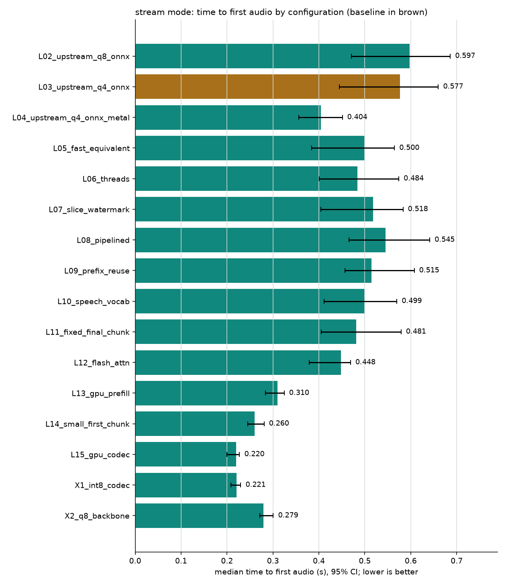
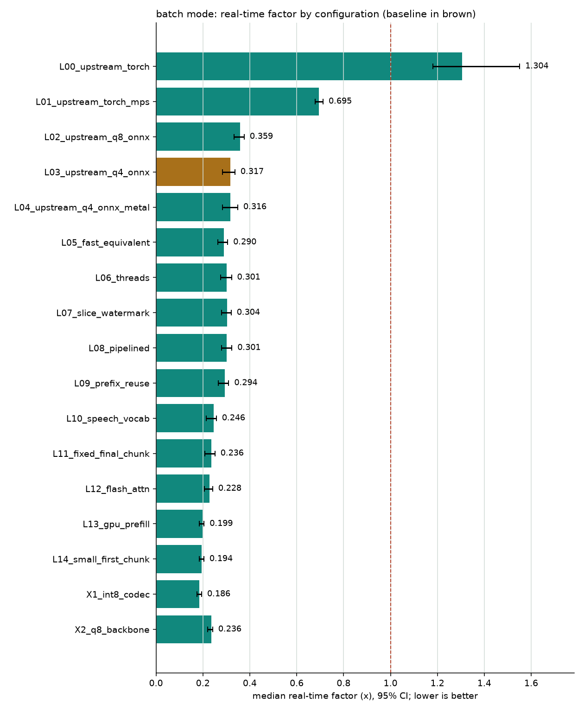
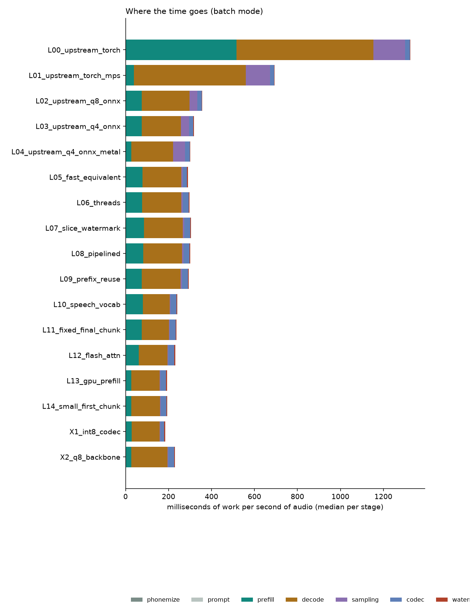
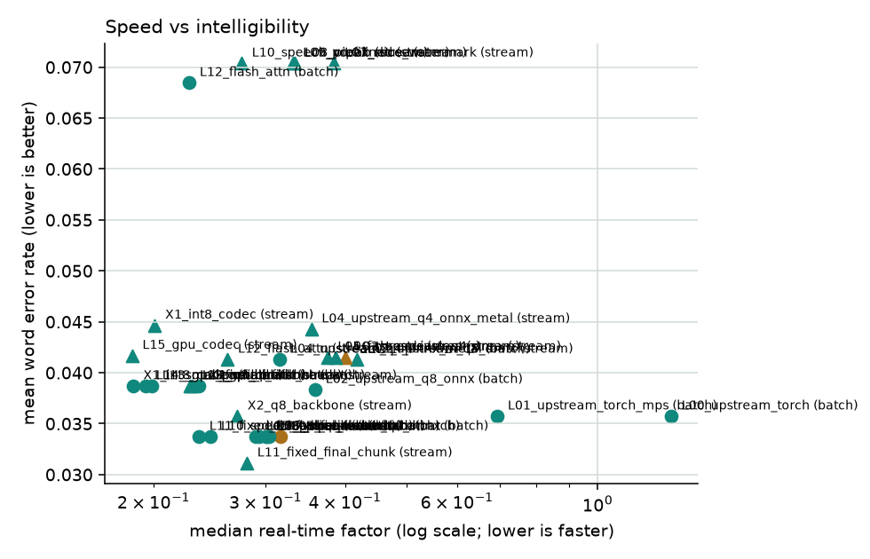

# NeuTTS benchmark report: `m4-ladder`

**Hardware:** Apple M4 · 10C/10T (4 perf) · 16.0 GB RAM · macOS-27.0.1-arm64-arm-64bit · Python 3.12.16  
**CPU features:** FEAT_BF16, FEAT_DotProd, FEAT_I8MM  
**llama.cpp build:** `MTL : EMBED_LIBRARY = 1 | CPU : NEON = 1 | ARM_FMA = 1 | FP16_VA = 1 | MATMUL_INT8 = 1 | DOTPROD = 1 | SME = 1 | SME2 = 1 | ACCELERATE = 1 | REPACK = 1 |`  
**Power:** {"on_ac_power": true, "battery_percent": 100, "low_power_mode": false}  
**Suite:** `ladder`: 18 configs, 1 repeats × 1 seeds × 2 voices, 1 round(s), warm-up 3, noise floor ±3%. Baseline: `L03_upstream_q4_onnx`.  
**Load pattern:** requests paced at playback speed (each waits until the previous audio would have finished playing, plus 0.5 s), as a voice app runs; 30 s idle before each configuration.  
**Quality scorers:** Whisper `small.en` (word error rate, corpus-level), ECAPA-TDNN speaker similarity, Perth watermark detection  
**Run:** 2026-11-01T03:25:20 → 2026-11-01T04:53:58

Every number is a median with a 95% bootstrap confidence interval in brackets. Comparisons are paired: each configuration ran the identical requests (sentence, voice, seed, repeat).

## Headline

- **stream:** time to first audio 0.577 → 0.220 with `L15_gpu_codec` (paired ratio 0.394× [0.365–0.413], quality gates passed).
- **batch:** real-time factor 0.317 → 0.236 with `L11_fixed_final_chunk` (paired ratio 0.731× [0.716–0.746], quality gates passed).

## Stream mode

| Config | TTFA s | Total s | RTF | Prefill tok/s | Decode tok/s | Peak memory MB (requests) | OK |
|---|---|---|---|---|---|---|---|
| `L02_upstream_q8_onnx` | 0.597 [0.471–0.686] | 1.728 [1.627–1.999] | 0.418 [0.400–0.452] | 2675 | 228 | 2906 | 24/24 |
| `L03_upstream_q4_onnx` | 0.577 [0.445–0.660] | 1.623 [1.531–1.795] | 0.400 [0.369–0.422] | 2669 | 275 | 2819 | 24/24 |
| `L04_upstream_q4_onnx_metal` | 0.404 [0.356–0.451] | 1.508 [1.327–1.605] | 0.354 [0.339–0.360] | 7748 | 280 | 2681 | 24/24 |
| `L05_fast_equivalent` | 0.500 [0.384–0.564] | 1.463 [1.407–1.614] | 0.375 [0.342–0.385] | 2559 | 277 | 2634 | 24/24 |
| `L06_threads` | 0.484 [0.401–0.574] | 1.578 [1.495–1.743] | 0.387 [0.365–0.407] | 2634 | 275 | 2632 | 24/24 |
| `L07_slice_watermark` | 0.518 [0.404–0.583] | 1.539 [1.451–1.718] | 0.385 [0.363–0.402] | 2426 | 276 | 2031 | 24/24 |
| `L08_pipelined` | 0.545 [0.465–0.641] | 1.330 [1.285–1.497] | 0.333 [0.309–0.360] | 2493 | 221 | 2047 | 24/24 |
| `L09_prefix_reuse` | 0.515 [0.456–0.608] | 1.315 [1.262–1.483] | 0.331 [0.307–0.342] | 2347 | 222 | 2149 | 24/24 |
| `L10_speech_vocab` | 0.499 [0.411–0.570] | 1.141 [1.058–1.246] | 0.275 [0.252–0.287] | 2308 | 308 | 1934 | 24/24 |
| `L11_fixed_final_chunk` | 0.481 [0.405–0.579] | 1.092 [1.012–1.237] | 0.281 [0.256–0.292] | 2328 | 308 | 1934 | 24/24 |
| `L12_flash_attn` | 0.448 [0.379–0.469] | 1.044 [0.989–1.197] | 0.262 [0.248–0.268] | 2783 | 296 | 1930 | 24/24 |
| `L13_gpu_prefill` | 0.310 [0.284–0.325] | 0.928 [0.887–1.022] | 0.228 [0.221–0.237] | 6355 | 288 | 2206 | 24/24 |
| `L14_small_first_chunk` | 0.260 [0.245–0.281] | 0.912 [0.886–1.038] | 0.230 [0.219–0.239] | 6333 | 284 | 2029 | 24/24 |
| `L15_gpu_codec` | 0.220 [0.199–0.227] | 0.764 [0.701–0.789] | 0.185 [0.169–0.192] | 6342 | 351 | 2959 | 24/24 |
| `X1_int8_codec` | 0.221 [0.208–0.230] | 0.801 [0.770–0.916] | 0.201 [0.188–0.211] | 6431 | 317 | 1591 | 24/24 |
| `X2_q8_backbone` | 0.279 [0.271–0.301] | 1.146 [1.092–1.230] | 0.271 [0.259–0.279] | 6336 | 227 | 2280 | 24/24 |

**Where the time goes** (median ms of work per second of audio):

| Config | phonemize | prompt | prefill | decode | sampling | codec | watermark | other |
|---|---|---|---|---|---|---|---|---|
| `L02_upstream_q8_onnx` | 1.0 | 0.1 | 65.2 | 219.0 | 38.0 | 83.3 | 15.4 | 0.8 |
| `L03_upstream_q4_onnx` | 1.0 | 0.1 | 69.0 | 181.6 | 38.0 | 89.2 | 15.0 | 0.8 |
| `L04_upstream_q4_onnx_metal` | 1.1 | 0.1 | 26.4 | 178.8 | 38.1 | 94.2 | 14.8 | 0.7 |
| `L05_fast_equivalent` | 0.4 | 1.0 | 81.3 | 180.9 | 6.6 | 85.7 | 14.1 | 0.3 |
| `L06_threads` | 0.4 | 1.1 | 74.2 | 182.1 | 6.6 | 108.7 | 13.5 | 0.3 |
| `L07_slice_watermark` | 0.4 | 1.0 | 82.5 | 181.5 | 6.6 | 107.7 | 5.7 | 0.3 |
| `L08_pipelined` | 0.4 | 1.0 | 77.1 | 226.0 | 7.0 | 199.8 | 7.1 | 0.0 |
| `L09_prefix_reuse` | 0.4 | 0.9 | 75.9 | 225.7 | 6.9 | 195.6 | 7.0 | 0.0 |
| `L10_speech_vocab` | 0.4 | 1.6 | 78.5 | 162.4 | 3.8 | 168.7 | 6.6 | 0.0 |
| `L11_fixed_final_chunk` | 0.4 | 1.7 | 81.1 | 163.3 | 3.8 | 169.6 | 6.6 | 0.0 |
| `L12_flash_attn` | 0.4 | 1.7 | 60.4 | 170.1 | 3.7 | 166.6 | 6.6 | 0.0 |
| `L13_gpu_prefill` | 0.4 | 1.7 | 24.6 | 174.8 | 3.4 | 164.7 | 6.6 | 0.0 |
| `L14_small_first_chunk` | 0.4 | 1.8 | 25.8 | 177.2 | 3.4 | 175.1 | 6.8 | 0.0 |
| `L15_gpu_codec` | 0.4 | 1.7 | 24.3 | 143.5 | 3.5 | 65.5 | 8.0 | 0.0 |
| `X1_int8_codec` | 0.4 | 1.7 | 25.2 | 158.6 | 3.4 | 97.8 | 7.1 | 0.0 |
| `X2_q8_backbone` | 0.4 | 1.6 | 23.7 | 221.9 | 3.5 | 203.7 | 7.2 | 0.0 |

**Streaming health:**

| Config | Requests with underruns | Median stall s | Min headroom s (p50) | Fidelity dB (vs one-pass decode) |
|---|---|---|---|---|
| `L02_upstream_q8_onnx` | 0/24 | 0.000 | 0.340 | 2.86 |
| `L03_upstream_q4_onnx` | 0/24 | 0.000 | 0.354 | 2.91 |
| `L04_upstream_q4_onnx_metal` | 0/24 | 0.000 | 0.355 | 2.98 |
| `L05_fast_equivalent` | 0/24 | 0.000 | 0.358 | 2.91 |
| `L06_threads` | 0/24 | 0.000 | 0.349 | 2.91 |
| `L07_slice_watermark` | 0/24 | 0.000 | 0.353 | 2.92 |
| `L08_pipelined` | 0/24 | 0.000 | 0.383 | 2.92 |
| `L09_prefix_reuse` | 0/24 | 0.000 | 0.384 | 2.92 |
| `L10_speech_vocab` | 0/24 | 0.000 | 0.404 | 2.92 |
| `L11_fixed_final_chunk` | 0/24 | 0.000 | 0.404 | 2.66 |
| `L12_flash_attn` | 0/24 | 0.000 | 0.407 | 2.69 |
| `L13_gpu_prefill` | 0/24 | 0.000 | 0.408 | 2.59 |
| `L14_small_first_chunk` | 0/24 | 0.000 | 0.108 | 2.58 |
| `L15_gpu_codec` | 0/24 | 0.000 | 0.147 | 2.76 |
| `X1_int8_codec` | 0/24 | 0.000 | 0.121 | 2.58 |
| `X2_q8_backbone` | 0/24 | 0.000 | 0.089 | 2.80 |

## Batch mode

| Config | TTFA s | Total s | RTF | Prefill tok/s | Decode tok/s | Peak memory MB (requests) | OK |
|---|---|---|---|---|---|---|---|
| `L00_upstream_torch` | 5.786 [5.121–6.060] | 5.786 [5.121–6.060] | 1.304 [1.180–1.551] | 361 | 78 | 2944 | 24/24 |
| `L01_upstream_torch_mps` | 3.102 [2.870–3.217] | 3.102 [2.870–3.217] | 0.695 [0.680–0.712] | 4993 | 96 | 6174 | 24/24 |
| `L02_upstream_q8_onnx` | 1.438 [1.338–1.612] | 1.438 [1.338–1.612] | 0.359 [0.334–0.376] | 2653 | 225 | 2761 | 24/24 |
| `L03_upstream_q4_onnx` | 1.268 [1.200–1.417] | 1.268 [1.200–1.417] | 0.317 [0.283–0.337] | 2694 | 275 | 2684 | 24/24 |
| `L04_upstream_q4_onnx_metal` | 1.264 [1.138–1.353] | 1.264 [1.138–1.353] | 0.316 [0.284–0.349] | 7800 | 258 | 2536 | 24/24 |
| `L05_fast_equivalent` | 1.161 [1.087–1.316] | 1.161 [1.087–1.316] | 0.290 [0.263–0.305] | 2599 | 279 | 2501 | 24/24 |
| `L06_threads` | 1.232 [1.166–1.373] | 1.232 [1.166–1.373] | 0.301 [0.276–0.322] | 2558 | 276 | 2501 | 24/24 |
| `L07_slice_watermark` | 1.214 [1.152–1.371] | 1.214 [1.152–1.371] | 0.304 [0.279–0.321] | 2384 | 277 | 2028 | 24/24 |
| `L08_pipelined` | 1.221 [1.152–1.390] | 1.221 [1.152–1.390] | 0.301 [0.280–0.323] | 2396 | 277 | 2059 | 24/24 |
| `L09_prefix_reuse` | 1.184 [1.139–1.333] | 1.184 [1.139–1.333] | 0.294 [0.266–0.310] | 2471 | 277 | 2146 | 24/24 |
| `L10_speech_vocab` | 1.001 [0.882–1.044] | 1.001 [0.882–1.044] | 0.246 [0.215–0.257] | 2247 | 401 | 1896 | 24/24 |
| `L11_fixed_final_chunk` | 0.958 [0.883–1.041] | 0.958 [0.883–1.041] | 0.236 [0.208–0.251] | 2413 | 401 | 1897 | 24/24 |
| `L12_flash_attn` | 0.906 [0.853–1.055] | 0.906 [0.853–1.055] | 0.228 [0.207–0.242] | 2890 | 392 | 1894 | 24/24 |
| `L13_gpu_prefill` | 0.817 [0.744–0.889] | 0.817 [0.744–0.889] | 0.199 [0.184–0.205] | 6484 | 382 | 2172 | 24/24 |
| `L14_small_first_chunk` | 0.822 [0.742–0.889] | 0.822 [0.742–0.889] | 0.194 [0.185–0.204] | 6387 | 381 | 1994 | 24/24 |
| `X1_int8_codec` | 0.787 [0.696–0.831] | 0.787 [0.696–0.831] | 0.186 [0.175–0.194] | 6122 | 384 | 1557 | 24/24 |
| `X2_q8_backbone` | 1.024 [0.932–1.102] | 1.024 [0.932–1.102] | 0.236 [0.221–0.242] | 6283 | 296 | 2244 | 24/24 |

**Where the time goes** (median ms of work per second of audio):

| Config | phonemize | prompt | prefill | decode | sampling | codec | watermark | other |
|---|---|---|---|---|---|---|---|---|
| `L00_upstream_torch` | 0.9 | 0.6 | 514.6 | 637.9 | 147.6 | 22.1 | 2.1 | 0.3 |
| `L01_upstream_torch_mps` | 0.9 | 0.8 | 37.3 | 521.2 | 113.0 | 17.9 | 2.2 | 0.3 |
| `L02_upstream_q8_onnx` | 1.1 | 0.1 | 73.4 | 223.4 | 35.9 | 20.3 | 3.2 | 0.0 |
| `L03_upstream_q4_onnx` | 1.1 | 0.1 | 73.9 | 183.1 | 37.8 | 19.8 | 3.4 | 0.0 |
| `L04_upstream_q4_onnx_metal` | 1.0 | 0.1 | 25.0 | 194.9 | 55.4 | 22.4 | 2.9 | 0.0 |
| `L05_fast_equivalent` | 0.4 | 1.1 | 78.0 | 180.4 | 6.6 | 19.7 | 3.9 | 0.0 |
| `L06_threads` | 0.4 | 1.0 | 75.9 | 181.9 | 6.7 | 27.6 | 3.8 | 0.0 |
| `L07_slice_watermark` | 0.4 | 1.0 | 84.2 | 181.4 | 6.7 | 27.3 | 3.8 | 0.0 |
| `L08_pipelined` | 0.4 | 1.0 | 80.3 | 181.3 | 6.7 | 27.9 | 3.8 | 0.0 |
| `L09_prefix_reuse` | 0.4 | 1.0 | 73.7 | 181.2 | 6.6 | 27.3 | 3.8 | 0.0 |
| `L10_speech_vocab` | 0.4 | 1.8 | 78.7 | 125.5 | 3.5 | 27.5 | 3.8 | 0.1 |
| `L11_fixed_final_chunk` | 0.4 | 1.8 | 73.8 | 125.6 | 3.5 | 27.5 | 3.8 | 0.0 |
| `L12_flash_attn` | 0.4 | 1.7 | 59.2 | 134.7 | 3.5 | 27.7 | 3.8 | 0.1 |
| `L13_gpu_prefill` | 0.4 | 1.8 | 24.2 | 131.9 | 3.2 | 27.3 | 3.8 | 0.0 |
| `L14_small_first_chunk` | 0.4 | 1.6 | 25.6 | 132.3 | 3.2 | 27.4 | 3.8 | 0.0 |
| `X1_int8_codec` | 0.4 | 1.7 | 26.0 | 131.1 | 3.2 | 17.9 | 3.8 | 0.0 |
| `X2_q8_backbone` | 0.4 | 1.7 | 24.2 | 169.8 | 3.2 | 27.5 | 3.8 | 0.0 |

## Compared with the baseline

Ratio = candidate ÷ baseline per request (below 1 is faster). Quality deltas are candidate − baseline; WER Δ is corpus-level (errors ÷ words over all sentences) with a paired bootstrap.

| Config | Mode | Primary metric ratio | Speed | WER Δ | Speaker sim Δ | Gates | Verdict |
|---|---|---|---|---|---|---|---|
| `L00_upstream_torch` | batch | 4.305× [4.133–4.543] | slower | +0.003 | -0.006 | wer:inconclusive, spk_sim:inconclusive, watermark:pass, failures:pass | **slower** |
| `L01_upstream_torch_mps` | batch | 2.171× [2.084–2.360] | slower | +0.003 | +0.000 | wer:inconclusive, spk_sim:inconclusive, watermark:pass, failures:pass | **slower** |
| `L02_upstream_q8_onnx` | batch | 1.131× [1.103–1.148] | slower | +0.006 | -0.011 | wer:inconclusive, spk_sim:inconclusive, watermark:pass, failures:pass | **slower** |
| `L02_upstream_q8_onnx` | stream | 1.042× [1.015–1.056] | within noise | +0.000 | -0.009 | wer:pass, spk_sim:inconclusive, watermark:pass, fidelity:pass, failures:pass | **no measurable change** |
| `L04_upstream_q4_onnx_metal` | batch | 0.940× [0.903–1.042] | within noise | +0.009 | +0.015 | wer:inconclusive, spk_sim:pass, watermark:pass, failures:pass | **no measurable change** |
| `L04_upstream_q4_onnx_metal` | stream | 0.705× [0.677–0.778] | faster | +0.003 | +0.006 | wer:pass, spk_sim:inconclusive, watermark:pass, fidelity:pass, failures:pass | **faster, quality needs more data** |
| `L05_fast_equivalent` | batch | 0.919× [0.910–0.929] | faster | +0.000 | +0.000 | wer:pass, spk_sim:pass, watermark:pass, failures:pass | **win** |
| `L05_fast_equivalent` | stream | 0.843× [0.819–0.877] | faster | +0.000 | +0.000 | wer:pass, spk_sim:pass, watermark:pass, fidelity:pass, failures:pass | **win** |
| `L06_threads` | batch | 0.951× [0.943–0.967] | faster | +0.000 | +0.000 | wer:pass, spk_sim:pass, watermark:pass, failures:pass | **win** |
| `L06_threads` | stream | 0.858× [0.845–0.902] | faster | +0.000 | +0.000 | wer:pass, spk_sim:pass, watermark:pass, fidelity:pass, failures:pass | **win** |
| `L07_slice_watermark` | batch | 0.966× [0.952–0.973] | within noise | +0.000 | +0.000 | wer:pass, spk_sim:pass, watermark:pass, failures:pass | **no measurable change** |
| `L07_slice_watermark` | stream | 0.880× [0.854–0.903] | faster | +0.026 | +0.000 | wer:inconclusive, spk_sim:pass, watermark:pass, fidelity:pass, failures:pass | **faster, quality needs more data** |
| `L08_pipelined` | batch | 0.962× [0.947–0.979] | within noise | +0.000 | +0.000 | wer:pass, spk_sim:pass, watermark:pass, failures:pass | **no measurable change** |
| `L08_pipelined` | stream | 0.979× [0.955–1.038] | within noise | +0.026 | +0.000 | wer:inconclusive, spk_sim:pass, watermark:pass, fidelity:pass, failures:pass | **no measurable change** |
| `L09_prefix_reuse` | batch | 0.923× [0.913–0.945] | faster | +0.000 | +0.000 | wer:pass, spk_sim:pass, watermark:pass, failures:pass | **win** |
| `L09_prefix_reuse` | stream | 0.949× [0.883–1.003] | within noise | +0.026 | +0.000 | wer:inconclusive, spk_sim:pass, watermark:pass, fidelity:pass, failures:pass | **no measurable change** |
| `L10_speech_vocab` | batch | 0.744× [0.719–0.764] | faster | +0.000 | +0.000 | wer:pass, spk_sim:pass, watermark:pass, failures:pass | **win** |
| `L10_speech_vocab` | stream | 0.886× [0.816–0.911] | faster | +0.026 | +0.000 | wer:inconclusive, spk_sim:pass, watermark:pass, fidelity:pass, failures:pass | **faster, quality needs more data** |
| `L11_fixed_final_chunk` | batch | 0.731× [0.716–0.746] | faster | +0.000 | +0.000 | wer:pass, spk_sim:pass, watermark:pass, failures:pass | **win** |
| `L11_fixed_final_chunk` | stream | 0.883× [0.807–0.911] | faster | -0.012 | +0.000 | wer:pass, spk_sim:pass, watermark:pass, fidelity:pass, failures:pass | **win** |
| `L12_flash_attn` | batch | 0.723× [0.706–0.734] | faster | +0.035 | -0.014 | wer:inconclusive, spk_sim:inconclusive, watermark:pass, failures:pass | **faster, quality needs more data** |
| `L12_flash_attn` | stream | 0.779× [0.734–0.812] | faster | +0.000 | -0.007 | wer:pass, spk_sim:inconclusive, watermark:pass, fidelity:pass, failures:pass | **faster, quality needs more data** |
| `L13_gpu_prefill` | batch | 0.626× [0.595–0.643] | faster | +0.006 | +0.021 | wer:inconclusive, spk_sim:pass, watermark:pass, failures:pass | **faster, quality needs more data** |
| `L13_gpu_prefill` | stream | 0.538× [0.504–0.630] | faster | -0.003 | +0.028 | wer:pass, spk_sim:pass, watermark:pass, fidelity:pass, failures:pass | **win** |
| `L14_small_first_chunk` | batch | 0.626× [0.596–0.638] | faster | +0.006 | +0.021 | wer:inconclusive, spk_sim:pass, watermark:pass, failures:pass | **faster, quality needs more data** |
| `L14_small_first_chunk` | stream | 0.457× [0.445–0.522] | faster | -0.003 | +0.033 | wer:pass, spk_sim:pass, watermark:pass, fidelity:pass, failures:pass | **win** |
| `L15_gpu_codec` | stream | 0.394× [0.365–0.413] | faster | +0.000 | +0.012 | wer:pass, spk_sim:pass, watermark:pass, fidelity:pass, failures:pass | **win** |
| `X1_int8_codec` | batch | 0.596× [0.572–0.609] | faster | +0.006 | +0.020 | wer:inconclusive, spk_sim:pass, watermark:pass, failures:pass | **faster, quality needs more data** |
| `X1_int8_codec` | stream | 0.389× [0.366–0.422] | faster | +0.003 | +0.032 | wer:inconclusive, spk_sim:pass, watermark:pass, fidelity:pass, failures:pass | **faster, quality needs more data** |
| `X2_q8_backbone` | batch | 0.746× [0.723–0.773] | faster | +0.006 | +0.005 | wer:inconclusive, spk_sim:inconclusive, watermark:pass, failures:pass | **faster, quality needs more data** |
| `X2_q8_backbone` | stream | 0.519× [0.474–0.577] | faster | -0.006 | +0.015 | wer:pass, spk_sim:pass, watermark:pass, fidelity:pass, failures:pass | **win** |

**Largest word-error changes against the baseline** (per sentence; listen to these first):

| Config | Mode | Sentence | Voice | WER Δ | Baseline heard | Candidate heard |
|---|---|---|---|---|---|---|
| `L00_upstream_torch` | batch | m08 | dave | +0.25 | Your package with tracking number four seven one nine will arrive tomorrow between noon an | Your package with tracking number 4719 will arrive tomorrow between noon and 3. |
| `L00_upstream_torch` | batch | m11 | dave | -0.08 | The temperature will drop to minus four tonight, so please wrap up war. | The temperature will drop to minus four tonight, so please wrap up warm. |
| `L00_upstream_torch` | batch | m10 | dave | +0.07 | Are you coming to Priya's birthday dinner on Saturday or are you still travelling? | Are you coming to Priya's birthday dinner on Saturday, or are you still traveling? |
| `L01_upstream_torch_mps` | batch | m08 | dave | +0.25 | Your package with tracking number four seven one nine will arrive tomorrow between noon an | Your package with tracking number 4719 will arrive tomorrow between noon and 3. |
| `L01_upstream_torch_mps` | batch | m11 | dave | -0.08 | The temperature will drop to minus four tonight, so please wrap up war. | The temperature will drop to minus four tonight, so please wrap up warm. |
| `L01_upstream_torch_mps` | batch | m01 | jo | -0.06 | The train to Manchester has been delayed by about 20 minutes because of a signal fall. | The train to Manchester has been delayed by about 20 minutes because of a signal fault. |
| `L02_upstream_q8_onnx` | batch | m08 | dave | +0.25 | Your package with tracking number four seven one nine will arrive tomorrow between noon an | Your package with tracking number 4719 will arrive tomorrow between noon and 3. |
| `L02_upstream_q8_onnx` | batch | m11 | dave | -0.08 | The temperature will drop to minus four tonight, so please wrap up war. | The temperature will drop to minus 4 tonight, so please wrap up warm. |
| `L02_upstream_q8_onnx` | batch | m10 | dave | +0.07 | Are you coming to Priya's birthday dinner on Saturday or are you still travelling? | Are you coming to Priya's birthday dinner on Saturday, or are you still traveling? |
| `L02_upstream_q8_onnx` | stream | m11 | dave | -0.08 | The temperature will drop to minus four tonight, so please wrap up war. | The temperature will drop to minus four tonight, so please wrap up warm. |
| `L02_upstream_q8_onnx` | stream | m02 | dave | +0.07 | Could you remind me to water the plants when I get home this evening? | Would you remind me to water the plants when I get home this evening? |
| `L02_upstream_q8_onnx` | stream | m10 | dave | +0.07 | Are you coming to Priya's birthday dinner on Saturday or are you still travelling? | Are you coming to Priya's birthday dinner on Saturday, or are you still traveling? |
| `L04_upstream_q4_onnx_metal` | batch | m08 | dave | +0.25 | Your package with tracking number four seven one nine will arrive tomorrow between noon an | Your package with tracking number 4719 will arrive tomorrow between noon and 3. |
| `L04_upstream_q4_onnx_metal` | batch | m11 | dave | -0.08 | The temperature will drop to minus four tonight, so please wrap up war. | The temperature will drop to minus four tonight, so please wrap up warm. |
| `L04_upstream_q4_onnx_metal` | batch | m10 | dave | +0.07 | Are you coming to Priya's birthday dinner on Saturday or are you still travelling? | Are you coming to Priya's birthday dinner on Saturday or are you still traveling? |
| `L04_upstream_q4_onnx_metal` | stream | m05 | jo | +0.14 | I'm not sure that's right. Let's check the figures again before we send it. | I'm not sure that's rights, check the figures again before we send it. |
| `L04_upstream_q4_onnx_metal` | stream | m11 | dave | -0.08 | The temperature will drop to minus four tonight, so please wrap up war. | The temperature will drop to minus four tonight, so please wrap up warm. |
| `L07_slice_watermark` | stream | m11 | jo | +0.69 | The temperature will drop to minus four tonight, so please wrap up warm. | The temperature will drop t |
| `L08_pipelined` | stream | m11 | jo | +0.69 | The temperature will drop to minus four tonight, so please wrap up warm. | The temperature will drop t |
| `L09_prefix_reuse` | stream | m11 | jo | +0.69 | The temperature will drop to minus four tonight, so please wrap up warm. | The temperature will drop t |
| `L10_speech_vocab` | stream | m11 | jo | +0.69 | The temperature will drop to minus four tonight, so please wrap up warm. | The temperature will drop t |
| `L11_fixed_final_chunk` | stream | m08 | dave | -0.25 | Your package with tracking number 4719 will arrive tomorrow between noon and 3. | Your package with tracking number four seven one nine will arrive tomorrow between noon an |
| `L12_flash_attn` | batch | m03 | dave | +0.86 | On the 3rd of March, Mrs Okafa moved into the flat on Queen Street. | Thank you. |
| `L12_flash_attn` | batch | m08 | dave | +0.25 | Your package with tracking number four seven one nine will arrive tomorrow between noon an | Your package with tracking number 4719 will arrive tomorrow between noon and 3. |
| `L12_flash_attn` | batch | m11 | dave | -0.08 | The temperature will drop to minus four tonight, so please wrap up war. | The temperature will drop to minus four tonight, so please wrap up warm. |
| `L12_flash_attn` | stream | m11 | dave | -0.08 | The temperature will drop to minus four tonight, so please wrap up war. | The temperature will drop to minus four tonight, so please wrap up warm. |
| `L12_flash_attn` | stream | m10 | dave | +0.07 | Are you coming to Priya's birthday dinner on Saturday or are you still travelling? | Are you coming to Priya's birthday dinner on Saturday, or are you still traveling? |
| `L13_gpu_prefill` | batch | m08 | dave | +0.25 | Your package with tracking number four seven one nine will arrive tomorrow between noon an | Your package with tracking number 4719 will arrive tomorrow between noon and 3. |
| `L13_gpu_prefill` | batch | m11 | dave | -0.08 | The temperature will drop to minus four tonight, so please wrap up war. | The temperature will drop to minus four tonight, so please wrap up warm. |
| `L13_gpu_prefill` | batch | m10 | dave | +0.07 | Are you coming to Priya's birthday dinner on Saturday or are you still travelling? | Are you coming to Priya's birthday dinner on Saturday, or are you still traveling? |
| `L13_gpu_prefill` | stream | m11 | dave | -0.08 | The temperature will drop to minus four tonight, so please wrap up war. | The temperature will drop to minus four tonight, so please wrap up warm. |
| `L13_gpu_prefill` | stream | m10 | dave | +0.07 | Are you coming to Priya's birthday dinner on Saturday or are you still travelling? | Are you coming to Priya's birthday dinner on Saturday or are you still traveling? |
| `L13_gpu_prefill` | stream | m01 | jo | -0.06 | The train to Manchester has been delayed by about 20 minutes because of a signal fall. | The train to Manchester has been delayed by about 20 minutes because of a signal fault. |
| `L14_small_first_chunk` | batch | m08 | dave | +0.25 | Your package with tracking number four seven one nine will arrive tomorrow between noon an | Your package with tracking number 4719 will arrive tomorrow between noon and 3. |
| `L14_small_first_chunk` | batch | m11 | dave | -0.08 | The temperature will drop to minus four tonight, so please wrap up war. | The temperature will drop to minus four tonight, so please wrap up warm. |
| `L14_small_first_chunk` | batch | m10 | dave | +0.07 | Are you coming to Priya's birthday dinner on Saturday or are you still travelling? | Are you coming to Priya's birthday dinner on Saturday, or are you still traveling? |
| `L14_small_first_chunk` | stream | m11 | dave | -0.08 | The temperature will drop to minus four tonight, so please wrap up war. | The temperature will drop to minus four tonight, so please wrap up warm. |
| `L14_small_first_chunk` | stream | m10 | dave | +0.07 | Are you coming to Priya's birthday dinner on Saturday or are you still travelling? | Are you coming to Priya's birthday dinner on Saturday or are you still traveling? |
| `L14_small_first_chunk` | stream | m01 | jo | -0.06 | The train to Manchester has been delayed by about 20 minutes because of a signal fall. | The train to Manchester has been delayed by about 20 minutes because of a signal fault. |
| `L15_gpu_codec` | stream | m11 | dave | -0.08 | The temperature will drop to minus four tonight, so please wrap up war. | The temperature will drop to minus 4 tonight so please wrap up warm. |
| `L15_gpu_codec` | stream | m10 | dave | +0.07 | Are you coming to Priya's birthday dinner on Saturday or are you still travelling? | Are you coming to Priya's birthday dinner on Saturday, or are you still traveling? |
| `L15_gpu_codec` | stream | m03 | jo | +0.07 | On the 3rd of March, Mrs. Akafur moved into the flat on Queen Street. | On the 3rd of March, Mrs. Oc ever moved into the flat on Queen Street. |
| `X1_int8_codec` | batch | m08 | dave | +0.25 | Your package with tracking number four seven one nine will arrive tomorrow between noon an | Your package with tracking number 4719 will arrive tomorrow between noon and 3. |
| `X1_int8_codec` | batch | m11 | dave | -0.08 | The temperature will drop to minus four tonight, so please wrap up war. | The temperature will drop to minus four tonight, so please wrap up warm. |
| `X1_int8_codec` | batch | m10 | dave | +0.07 | Are you coming to Priya's birthday dinner on Saturday or are you still travelling? | are you coming to Priya's birthday dinner on Saturday, or are you still traveling? |
| `X1_int8_codec` | stream | m03 | dave | +0.14 | On the 3rd of March, Mrs Okafo moved into the flat on Queen Street. | on 3rd March Mrs O'Cuffer moved into the flat on Queen Street. |
| `X1_int8_codec` | stream | m11 | dave | -0.08 | The temperature will drop to minus four tonight, so please wrap up war. | The temperature will drop to minus four tonight, so please wrap up warm. |
| `X1_int8_codec` | stream | m10 | dave | +0.07 | Are you coming to Priya's birthday dinner on Saturday or are you still travelling? | Are you coming to Priya's birthday dinner on Saturday or are you still traveling? |
| `X2_q8_backbone` | batch | m08 | dave | +0.25 | Your package with tracking number four seven one nine will arrive tomorrow between noon an | Your package with tracking number 4719 will arrive tomorrow between noon and 3. |
| `X2_q8_backbone` | batch | m11 | dave | -0.08 | The temperature will drop to minus four tonight, so please wrap up war. | The temperature will drop to minus 4 tonight, so please wrap up warm. |
| `X2_q8_backbone` | batch | m10 | dave | +0.07 | Are you coming to Priya's birthday dinner on Saturday or are you still travelling? | Are you coming to Priya's birthday dinner on Saturday, or are you still traveling? |
| `X2_q8_backbone` | stream | m11 | dave | -0.08 | The temperature will drop to minus four tonight, so please wrap up war. | The temperature will drop to minus four tonight, so please wrap up warm. |
| `X2_q8_backbone` | stream | m01 | jo | -0.06 | The train to Manchester has been delayed by about 20 minutes because of a signal fall. | The train to Manchester has been delayed by about 20 minutes because of a signal fault. |

## Quality

| Config | Mode | WER (corpus) | WER (mean per sentence) | CER (mean) | Speaker sim (mean) | MOS | Watermark detected | Errors | Non-EOS stops | Long silences |
|---|---|---|---|---|---|---|---|---|---|---|
| `L00_upstream_torch` | batch | 0.038 | 0.036 | 0.026 | 0.534 | – | 100% | 0 | 0 | 0 |
| `L01_upstream_torch_mps` | batch | 0.038 | 0.036 | 0.028 | 0.540 | – | 100% | 0 | 0 | 0 |
| `L02_upstream_q8_onnx` | batch | 0.041 | 0.038 | 0.027 | 0.530 | – | 100% | 0 | 0 | 1 |
| `L02_upstream_q8_onnx` | stream | 0.044 | 0.041 | 0.027 | 0.539 | – | 100% | 0 | 0 | 1 |
| `L03_upstream_q4_onnx` | batch | 0.035 | 0.034 | 0.021 | 0.540 | – | 100% | 0 | 0 | 0 |
| `L03_upstream_q4_onnx` | stream | 0.044 | 0.042 | 0.027 | 0.549 | – | 100% | 0 | 0 | 0 |
| `L04_upstream_q4_onnx_metal` | batch | 0.044 | 0.041 | 0.030 | 0.555 | – | 100% | 0 | 0 | 1 |
| `L04_upstream_q4_onnx_metal` | stream | 0.047 | 0.044 | 0.031 | 0.555 | – | 100% | 0 | 0 | 1 |
| `L05_fast_equivalent` | batch | 0.035 | 0.034 | 0.021 | 0.540 | – | 100% | 0 | 0 | 0 |
| `L05_fast_equivalent` | stream | 0.044 | 0.042 | 0.027 | 0.549 | – | 100% | 0 | 0 | 0 |
| `L06_threads` | batch | 0.035 | 0.034 | 0.021 | 0.540 | – | 100% | 0 | 0 | 0 |
| `L06_threads` | stream | 0.044 | 0.042 | 0.027 | 0.549 | – | 100% | 0 | 0 | 0 |
| `L07_slice_watermark` | batch | 0.035 | 0.034 | 0.021 | 0.540 | – | 100% | 0 | 0 | 0 |
| `L07_slice_watermark` | stream | 0.070 | 0.070 | 0.053 | 0.549 | – | 100% | 0 | 0 | 0 |
| `L08_pipelined` | batch | 0.035 | 0.034 | 0.021 | 0.540 | – | 100% | 0 | 0 | 0 |
| `L08_pipelined` | stream | 0.070 | 0.070 | 0.053 | 0.549 | – | 100% | 0 | 0 | 0 |
| `L09_prefix_reuse` | batch | 0.035 | 0.034 | 0.021 | 0.540 | – | 100% | 0 | 0 | 0 |
| `L09_prefix_reuse` | stream | 0.070 | 0.070 | 0.053 | 0.549 | – | 100% | 0 | 0 | 0 |
| `L10_speech_vocab` | batch | 0.035 | 0.034 | 0.021 | 0.540 | – | 100% | 0 | 0 | 0 |
| `L10_speech_vocab` | stream | 0.070 | 0.070 | 0.053 | 0.549 | – | 100% | 0 | 0 | 0 |
| `L11_fixed_final_chunk` | batch | 0.035 | 0.034 | 0.021 | 0.540 | – | 100% | 0 | 0 | 0 |
| `L11_fixed_final_chunk` | stream | 0.032 | 0.031 | 0.018 | 0.549 | – | 100% | 0 | 0 | 0 |
| `L12_flash_attn` | batch | 0.070 | 0.068 | 0.059 | 0.526 | – | 100% | 0 | 0 | 0 |
| `L12_flash_attn` | stream | 0.044 | 0.041 | 0.031 | 0.542 | – | 100% | 0 | 0 | 1 |
| `L13_gpu_prefill` | batch | 0.041 | 0.039 | 0.030 | 0.561 | – | 100% | 0 | 0 | 0 |
| `L13_gpu_prefill` | stream | 0.041 | 0.039 | 0.031 | 0.577 | – | 100% | 0 | 0 | 0 |
| `L14_small_first_chunk` | batch | 0.041 | 0.039 | 0.030 | 0.561 | – | 100% | 0 | 0 | 0 |
| `L14_small_first_chunk` | stream | 0.041 | 0.039 | 0.031 | 0.582 | – | 100% | 0 | 0 | 0 |
| `L15_gpu_codec` | stream | 0.044 | 0.042 | 0.032 | 0.561 | – | 100% | 0 | 0 | 0 |
| `X1_int8_codec` | batch | 0.041 | 0.039 | 0.030 | 0.560 | – | 100% | 0 | 0 | 0 |
| `X1_int8_codec` | stream | 0.047 | 0.045 | 0.036 | 0.581 | – | 100% | 0 | 0 | 0 |
| `X2_q8_backbone` | batch | 0.041 | 0.039 | 0.026 | 0.545 | – | 100% | 0 | 0 | 1 |
| `X2_q8_backbone` | stream | 0.038 | 0.036 | 0.028 | 0.564 | – | 100% | 0 | 0 | 1 |

## Start-up and memory

Memory is the process's physical footprint (includes Metal/GPU allocations).
The cold request is the first real request after load, in the mode shown.

| Config | Load s | Cold first request: TTFA s (mode) | Memory after load MB | Peak during load MB |
|---|---|---|---|---|
| `L00_upstream_torch` | 16.12 | 4.448 (batch) | 2976 | 3214 |
| `L01_upstream_torch_mps` | 17.09 | 3.197 (batch) | 5853 | 6192 |
| `L02_upstream_q8_onnx` | 13.46 | 1.064 (batch) | 1905 | 1905 |
| `L03_upstream_q4_onnx` | 12.35 | 0.991 (batch) | 1832 | 1832 |
| `L04_upstream_q4_onnx_metal` | 11.47 | 0.913 (batch) | 1656 | 1656 |
| `L05_fast_equivalent` | 3.92 | 0.947 (batch) | 1676 | 1676 |
| `L06_threads` | 4.73 | 1.063 (batch) | 1678 | 1678 |
| `L07_slice_watermark` | 3.56 | 0.885 (batch) | 1680 | 1680 |
| `L08_pipelined` | 4.35 | 1.060 (batch) | 1677 | 1677 |
| `L09_prefix_reuse` | 3.86 | 0.891 (batch) | 1679 | 1679 |
| `L10_speech_vocab` | 9.70 | 0.818 (batch) | 1601 | 1601 |
| `L11_fixed_final_chunk` | 9.14 | 0.764 (batch) | 1602 | 1602 |
| `L12_flash_attn` | 8.14 | 0.739 (batch) | 1602 | 1602 |
| `L13_gpu_prefill` | 8.79 | 0.519 (batch) | 1647 | 1647 |
| `L14_small_first_chunk` | 9.11 | 0.511 (batch) | 1648 | 1648 |
| `L15_gpu_codec` | 16.49 | 0.344 (stream) | 2926 | 3288 |
| `X1_int8_codec` | 9.05 | 0.508 (batch) | 1087 | 1087 |
| `X2_q8_backbone` | 8.93 | 0.718 (batch) | 1706 | 1706 |

## Charts






## Reproduce

```bash
python -m ttsbench all suites/<suite>.yaml
```
