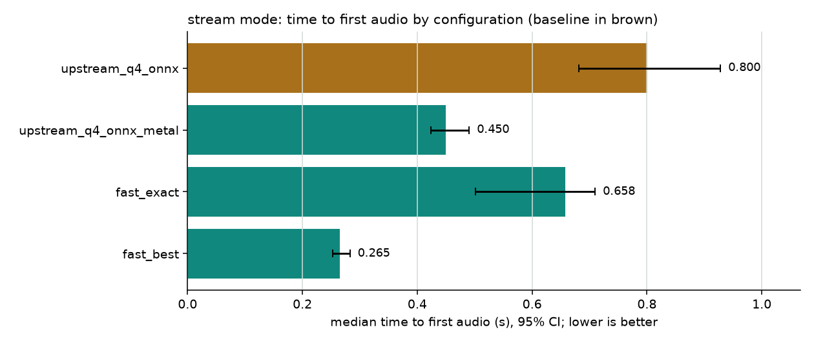
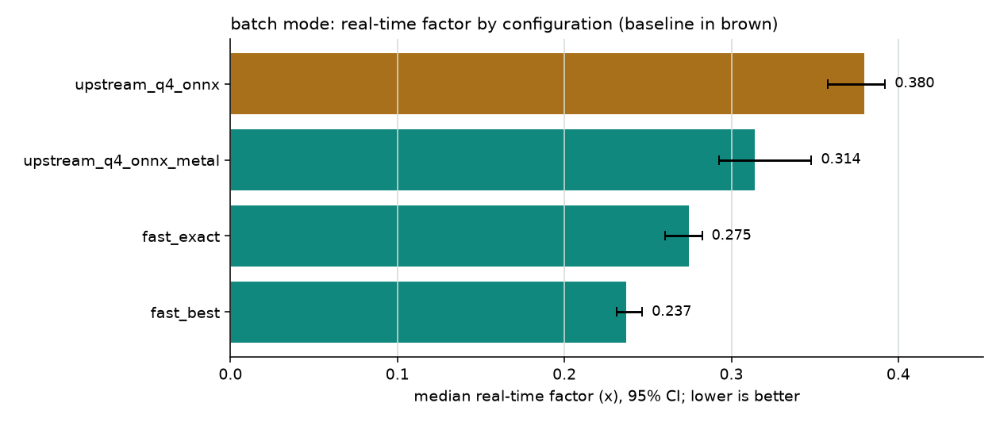
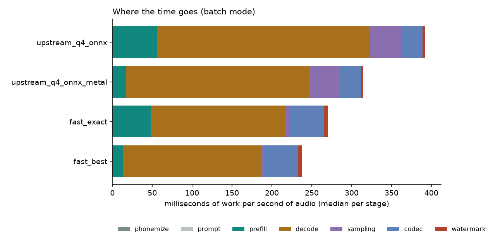
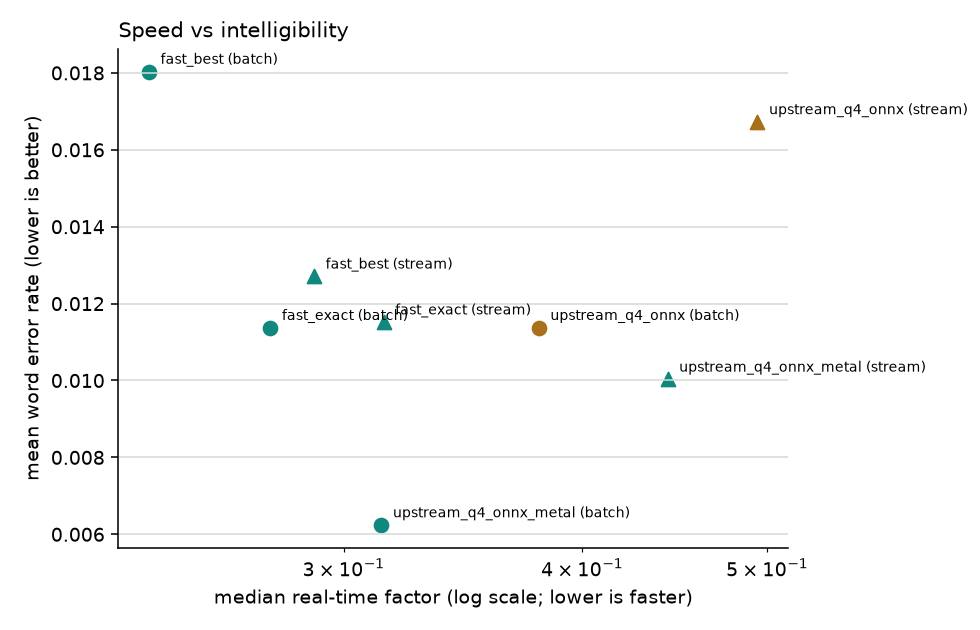

# NeuTTS benchmark report: `m4-sustained`

**Hardware:** Apple M4 · 10C/10T (4 perf) · 16.0 GB RAM · macOS-27.0.1-arm64-arm-64bit · Python 3.12.16  
**CPU features:** FEAT_BF16, FEAT_DotProd, FEAT_I8MM  
**llama.cpp build:** `MTL : EMBED_LIBRARY = 1 | CPU : NEON = 1 | ARM_FMA = 1 | FP16_VA = 1 | MATMUL_INT8 = 1 | DOTPROD = 1 | SME = 1 | SME2 = 1 | ACCELERATE = 1 | REPACK = 1 |`  
**Power:** {"on_ac_power": true, "battery_percent": 100, "low_power_mode": false}  
**Suite:** `sustained`: 4 configs, 1 repeats × 1 seeds × 2 voices, 2 round(s), warm-up 3, noise floor ±3%. Baseline: `upstream_q4_onnx`.  
**Load pattern:** back to back (sustained load); 30 s idle before each configuration.  
**Quality scorers:** Whisper `small.en` (word error rate, corpus-level), ECAPA-TDNN speaker similarity, Perth watermark detection  
**Run:** 2026-11-01T05:15:07 → 2026-11-01T05:39:39

Every number is a median with a 95% bootstrap confidence interval in brackets. Comparisons are paired: each configuration ran the identical requests (sentence, voice, seed, repeat).

## Headline

- **stream:** time to first audio 0.800 → 0.658 with `fast_exact` (paired ratio 0.775× [0.731–0.812], quality gates passed).
- **batch:** real-time factor 0.380 → 0.275 with `fast_exact` (paired ratio 0.736× [0.719–0.762], quality gates passed).

## Stream mode

| Config | TTFA s | Total s | RTF | Prefill tok/s | Decode tok/s | Peak memory MB (requests) | OK |
|---|---|---|---|---|---|---|---|
| `upstream_q4_onnx` | 0.800 [0.681–0.928] | 3.911 [3.552–4.180] | 0.494 [0.453–0.523] | 1986 | 205 | 3709 | 48/48 |
| `upstream_q4_onnx_metal` | 0.450 [0.423–0.490] | 3.439 [3.145–3.762] | 0.443 [0.407–0.474] | 7062 | 230 | 3449 | 48/48 |
| `fast_exact` | 0.658 [0.502–0.710] | 2.561 [2.482–2.675] | 0.315 [0.305–0.325] | 1979 | 210 | 2616 | 48/48 |
| `fast_best` | 0.265 [0.252–0.283] | 2.255 [2.201–2.440] | 0.289 [0.271–0.296] | 6915 | 200 | 2673 | 48/48 |

**Where the time goes** (median ms of work per second of audio):

| Config | phonemize | prompt | prefill | decode | sampling | codec | watermark | other |
|---|---|---|---|---|---|---|---|---|
| `upstream_q4_onnx` | 0.2 | 0.0 | 56.3 | 243.7 | 41.1 | 125.9 | 20.4 | 1.5 |
| `upstream_q4_onnx_metal` | 0.2 | 0.0 | 15.6 | 217.6 | 41.1 | 139.4 | 19.6 | 1.5 |
| `fast_exact` | 0.1 | 0.4 | 51.5 | 239.2 | 5.0 | 242.8 | 11.2 | 0.0 |
| `fast_best` | 0.1 | 0.5 | 14.2 | 250.7 | 4.7 | 233.4 | 10.7 | 0.0 |

**Streaming health:**

| Config | Requests with underruns | Median stall s | Min headroom s (p50) | Fidelity dB (vs one-pass decode) |
|---|---|---|---|---|
| `upstream_q4_onnx` | 0/48 | 0.000 | 0.286 | 2.79 |
| `upstream_q4_onnx_metal` | 0/48 | 0.000 | 0.320 | 2.91 |
| `fast_exact` | 0/48 | 0.000 | 0.374 | 2.70 |
| `fast_best` | 0/48 | 0.000 | 0.091 | 2.88 |

## Batch mode

| Config | TTFA s | Total s | RTF | Prefill tok/s | Decode tok/s | Peak memory MB (requests) | OK |
|---|---|---|---|---|---|---|---|
| `upstream_q4_onnx` | 3.086 [2.899–3.340] | 3.086 [2.899–3.340] | 0.380 [0.358–0.392] | 1954 | 188 | 3662 | 48/48 |
| `upstream_q4_onnx_metal` | 2.495 [2.340–2.742] | 2.496 [2.340–2.742] | 0.314 [0.293–0.348] | 7105 | 218 | 3398 | 48/48 |
| `fast_exact` | 2.243 [2.157–2.361] | 2.243 [2.157–2.361] | 0.275 [0.260–0.282] | 1911 | 295 | 2606 | 48/48 |
| `fast_best` | 1.933 [1.827–2.011] | 1.933 [1.827–2.011] | 0.237 [0.231–0.247] | 7033 | 290 | 2644 | 48/48 |

**Where the time goes** (median ms of work per second of audio):

| Config | phonemize | prompt | prefill | decode | sampling | codec | watermark | other |
|---|---|---|---|---|---|---|---|---|
| `upstream_q4_onnx` | 0.2 | 0.0 | 55.4 | 267.2 | 39.5 | 26.6 | 3.5 | 0.0 |
| `upstream_q4_onnx_metal` | 0.2 | 0.0 | 16.9 | 229.8 | 38.5 | 26.5 | 2.7 | 0.0 |
| `fast_exact` | 0.1 | 0.4 | 47.7 | 169.8 | 4.7 | 43.0 | 4.8 | 0.0 |
| `fast_best` | 0.1 | 0.5 | 12.3 | 172.9 | 4.4 | 42.1 | 4.9 | 0.0 |

## Compared with the baseline

Ratio = candidate ÷ baseline per request (below 1 is faster). Quality deltas are candidate − baseline; WER Δ is corpus-level (errors ÷ words over all sentences) with a paired bootstrap.

| Config | Mode | Primary metric ratio | Speed | WER Δ | Speaker sim Δ | Gates | Verdict |
|---|---|---|---|---|---|---|---|
| `upstream_q4_onnx_metal` | batch | 0.829× [0.800–0.858] | faster | -0.006 | -0.009 | wer:pass, spk_sim:inconclusive, watermark:pass, failures:pass | **faster, quality needs more data** |
| `upstream_q4_onnx_metal` | stream | 0.582× [0.561–0.626] | faster | -0.007 | -0.011 | wer:pass, spk_sim:inconclusive, watermark:pass, fidelity:pass, failures:pass | **faster, quality needs more data** |
| `fast_exact` | batch | 0.736× [0.719–0.762] | faster | +0.000 | +0.001 | wer:pass, spk_sim:pass, watermark:pass, failures:pass | **win** |
| `fast_exact` | stream | 0.775× [0.731–0.812] | faster | -0.006 | +0.001 | wer:pass, spk_sim:pass, watermark:pass, fidelity:pass, failures:pass | **win** |
| `fast_best` | batch | 0.634× [0.617–0.660] | faster | +0.007 | -0.001 | wer:inconclusive, spk_sim:inconclusive, watermark:pass, failures:pass | **faster, quality needs more data** |
| `fast_best` | stream | 0.332× [0.316–0.377] | faster | -0.004 | -0.020 | wer:pass, spk_sim:inconclusive, watermark:pass, fidelity:pass, failures:pass | **faster, quality needs more data** |

**Largest word-error changes against the baseline** (per sentence; listen to these first):

| Config | Mode | Sentence | Voice | WER Δ | Baseline heard | Candidate heard |
|---|---|---|---|---|---|---|
| `upstream_q4_onnx_metal` | batch | l12 | dave | -0.09 | If you need to cancel or change your booking, please let us know at least 48 hours in adva | If you need to cancel or change your booking, please let us know at least 48 hours in adva |
| `upstream_q4_onnx_metal` | batch | l08 | dave | -0.03 | does the kettle always seem to take twice as long to boil when you are standing right next | Why does the kettle always seem to take twice as long to boil when you are standing right  |
| `upstream_q4_onnx_metal` | stream | l02 | dave | -0.12 | Our support team is available from Monday to Friday between AA.M and APA.M, and you can al | Our support team is available from Monday to Friday between 8 a.m. and 8 p.m. And you can  |
| `upstream_q4_onnx_metal` | stream | l10 | dave | -0.04 | The recipe calls for two cups of flour, one teaspoon of salt, free eggs, and a generous sp | The recipe calls for two cups of flour, one teaspoon of salt, three eggs and a generous sp |
| `fast_exact` | stream | l02 | dave | -0.12 | Our support team is available from Monday to Friday between AA.M and APA.M, and you can al | Our support team is available from Monday to Friday between 8a.m and 8p.m, and you can als |
| `fast_best` | batch | l02 | jo | +0.25 | Our support team is available from Monday to Friday between 8am and 8p.m. And you can also | Our support team is available from Monday to Friday between 888M and 8P.M, and you can als |
| `fast_best` | batch | l12 | dave | -0.09 | If you need to cancel or change your booking, please let us know at least 48 hours in adva | If you need to cancel or change your booking please let us know at least 48 hours in advan |
| `fast_best` | batch | l02 | dave | +0.06 | Our support team is available from Monday to Friday between 8a.m and 8p.m, and you can als | Our support team is available from Monday to Friday between eight ed.m and eight p.m. And  |
| `fast_best` | stream | l02 | dave | -0.12 | Our support team is available from Monday to Friday between AA.M and APA.M, and you can al | Our support team is available from Monday to Friday between 8a.m and 8p.m and you can also |
| `fast_best` | stream | l02 | jo | +0.09 | Our support team is available from Monday to Friday between 8am and 8p.m. And you can also | Our support team is available from Monday to Friday between 8am and 8pm and you can also r |
| `fast_best` | stream | l10 | dave | -0.04 | The recipe calls for two cups of flour, one teaspoon of salt, free eggs, and a generous sp | The recipe calls for 2 cups of flour, 1 teaspoon of salt, 3 eggs, and a generous splash of |

## Quality

| Config | Mode | WER (corpus) | WER (mean per sentence) | CER (mean) | Speaker sim (mean) | MOS | Watermark detected | Errors | Non-EOS stops | Long silences |
|---|---|---|---|---|---|---|---|---|---|---|
| `upstream_q4_onnx` | batch | 0.013 | 0.011 | 0.007 | 0.614 | – | 100% | 0 | 0 | 0 |
| `upstream_q4_onnx` | stream | 0.018 | 0.017 | 0.009 | 0.634 | – | 100% | 0 | 0 | 0 |
| `upstream_q4_onnx_metal` | batch | 0.007 | 0.006 | 0.003 | 0.605 | – | 100% | 0 | 0 | 0 |
| `upstream_q4_onnx_metal` | stream | 0.011 | 0.010 | 0.005 | 0.622 | – | 100% | 0 | 0 | 0 |
| `fast_exact` | batch | 0.013 | 0.011 | 0.007 | 0.615 | – | 100% | 0 | 0 | 0 |
| `fast_exact` | stream | 0.013 | 0.012 | 0.006 | 0.635 | – | 100% | 0 | 0 | 0 |
| `fast_best` | batch | 0.020 | 0.018 | 0.011 | 0.613 | – | 100% | 0 | 0 | 0 |
| `fast_best` | stream | 0.014 | 0.013 | 0.008 | 0.614 | – | 100% | 0 | 0 | 0 |

## Start-up and memory

Memory is the process's physical footprint (includes Metal/GPU allocations).
The cold request is the first real request after load, in the mode shown.

| Config | Load s | Cold first request: TTFA s (mode) | Memory after load MB | Peak during load MB |
|---|---|---|---|---|
| `upstream_q4_onnx` | 13.02 | 0.993 (batch) | 1833 | 1833 |
| `upstream_q4_onnx_metal` | 13.19 | 0.932 (batch) | 1657 | 1657 |
| `fast_exact` | 9.71 | 0.915 (batch) | 1601 | 1601 |
| `fast_best` | 8.28 | 0.524 (batch) | 1647 | 1647 |

## Charts






## Reproduce

```bash
python -m ttsbench all suites/<suite>.yaml
```
